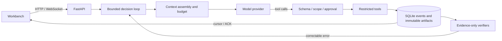

# Agent Harness

A self-built agent harness in Python (FastAPI + asyncio), with a local web workbench. The model only *proposes* tool calls; the harness validates scope and approvals, persists intent and results before streaming events, verifies what the model publishes against tool evidence, and recovers safely after a crash. No agent framework's loop is used — the loop, context management, tool policy, state machine and recovery are all in this repository.

[繁體中文說明](README.zh-TW.md)



## What it demonstrates

| Capability | How it is built |
|---|---|
| Planning and self-correction | A visible plan, then model → tool → result → next decision. Recoverable errors return to the model with the fields it may change and its remaining budget; operations with unknown effects are never retried automatically. |
| State machine and async execution | Explicit Run and tool-attempt states; terminal states cannot be reopened by late results. Bounded asyncio concurrency, cancellation, and safe continuation after a process crash. While a Run works, the user can add a message; it reaches the model at the next decision. |
| Streaming | Events are written to SQLite before they are pushed; the WebSocket resumes from a cursor with ACKs and de-duplication. Re-submitting the same key returns the original Run. |
| Context engineering | Every request is measured first. Over budget, the harness applies lossless moves, then labelled lossy omissions, and otherwise stops — it never silently truncates. |
| Memory and routing | User-saved, versioned memories selected by scope and relevance; the tool catalogue depends only on the selected source types. |
| Tool policy and verification | Schema and source-version checks, single-use approvals (of the plan before anything runs, a publication, or a tool that may change data), intent persisted before dispatch. Before publication, [verifiers](src/agent_harness_demo/verifiers.py) that **never see the task text** check that computed values cite the calculation that produced them, that one field does not mix values the sources give under different roles, and that the completion reply agrees with what was published. |
| Provider independence | The same loop runs on a local Ollama model, any OpenAI-compatible endpoint, or Claude through the official Anthropic SDK. |

Because verifiers only receive the artifact and tool evidence, the harness cannot encode answers for particular tasks. The [evaluation notes](docs/evaluation.md) show why that matters: removing earlier task-specific rules dropped a fixed six-case score from 6/6 to 3/6, and the score was then rebuilt with general mechanisms only.

## Quick start

Requires Python 3.12+ and [uv](https://docs.astral.sh/uv/).

```bash
uv sync --locked
uv run python -m agent_harness_demo --store .private/demo --port 8787
```

Open the address it prints — `http://127.0.0.1:8787/?token=…` — and press **Use sample data**. Each launch generates an access token (or uses `AGENT_HARNESS_TOKEN`); the browser trades it for a cookie, and scripts send it as `Authorization: Bearer <token>`, so other local processes cannot use the API. The workbench speaks English or Traditional Chinese (the switch under the logo; it follows your browser language until you choose). The API, events and code are in English; text that comes from your files or the model stays as written. Without a model flag a clearly labelled scripted fixture answers, so you can explore the workbench, approvals, cancellation and event stream without any model or key.

With a real model:

```bash
# Claude (official SDK). The key is read from the environment, never passed as a flag.
export ANTHROPIC_API_KEY=...
uv run python -m agent_harness_demo --provider anthropic --store .private/claude

# Any OpenAI-compatible Chat Completions endpoint
export OPENAI_API_KEY=...
uv run python -m agent_harness_demo --provider openai --model <model> --base-url https://api.openai.com/v1 --store .private/openai

# A local Ollama model that is already installed
uv run python -m agent_harness_demo --model qwen3.5:9b-q4_K_M --decision-protocol json_tools --store .private/local
```

The local path needs Ollama 0.40.10 with a Qwen3.5 model, because its context bound is verified against that renderer; any other local model fails closed with `context_profile_unsupported` instead of guessing.

Or with Docker (fixture by default; publish only to loopback):

```bash
docker build -t agent-harness .
docker run --rm -p 127.0.0.1:8787:8787 agent-harness   # prints the address with its token
docker run --rm -p 127.0.0.1:8787:8787 -e ANTHROPIC_API_KEY agent-harness --provider anthropic
```

Remote providers cost money per call. Claude defaults to `claude-opus-5-5` at effort `low`; use `--effort` and `--context-window` to tune it. Add `--alt-model <name>` (repeatable) to let each task choose another model of the same provider; the workbench then shows model and effort selectors, and the API accepts `"model"` and, for Claude, `"effort"`. A Run records its choice and a resume keeps it. Every Run totals the input and output tokens its provider reports (`token_usage` in the API, shown under the Run in the workbench). For a cost estimate, give prices in US dollars per million tokens, such as `--price claude-opus-5-5=5,25`; there is no built-in price table, because prices change. A Run pins its model's price when it starts, and an estimate that includes replies without reported usage is marked partial. Claude's private reasoning is never replayed, because the harness rewrites history by design — see [architecture](docs/architecture.md#providers).

### Approving the plan first

Tick “Let me approve the plan before sources are read and the Run proceeds”, or send `"require_plan_approval": true`, and the Run pauses at its plan: nothing else runs until you approve it. “Request changes” sends the plan back to the model with your optional note, and the model proposes another. A plan the model revises later needs a new approval; going back to the approved plan does not. A change request is your decision, so it does not use up the model's correction budget. A resumed Run keeps the plan you approved.

### Project instructions (AGENTS.md)

Put house rules for a workspace in an `AGENTS.md` at its root (UTF-8, at most 8 KiB). When the folder has one, the workbench shows it with an “Apply the workspace's AGENTS.md” checkbox and a preview; the API takes `"project_instructions": true`, and headless mode `--project-instructions`. The Run pins the text and its SHA-256 when it starts, so editing the file later does not change a running or resumed Run, and the event stream records which version applied. The instructions shape how the work is done; they are placed below the harness rules and cannot add sources, tools or approvals.

### PDF and Word sources

PDF and Word (`.docx`) files in the workspace are listed with the other sources. The model reads their extracted text: PDF pages are marked `[page N]`, and Word tables become `cell | cell` rows. Citations and change detection use the hash of the file itself. A scanned PDF without a text layer, an encrypted PDF or a damaged file is refused with a reason rather than read as empty. Limits: 10 MiB per file, 200 pages, 50 MiB unpacked for `.docx`, and 256 KiB of extracted text.

“Upload files” under the source list (or `POST /api/workspaces/{id}/uploads?name=<file>` with the raw bytes) saves files into the workspace's `uploads/` folder, where they become sources and are selected for the task. Each file is checked before anything is written: a plain file name with a source type, the type's size limit, and readability (UTF-8 text, or a PDF/Word file with extractable text). Uploads never overwrite: sending identical bytes again returns the saved file, and different bytes under an existing name are refused.

### Comparing versions

A revision publishes a new version and keeps the original. In the preview pane, “Compare with previous version” shows a unified diff with added and removed line counts; `GET /api/runs/{run}/artifacts/{artifact}/diff` returns the same, against the parent version or `?against=` any other artifact of the Session. Both versions must still match their recorded SHA-256.

### Headless mode

Run one task on a running workbench from a script or CI job. Every saved event is printed as one JSON line, then a `headless.result` line with the final status and artifact links:

```bash
export AGENT_HARNESS_TOKEN=...   # the token the workbench was started with
uv run python -m agent_harness_demo.headless --workspace ./docs --source notes.md --task "Summarise the notes into summary.md"
```

Exit codes: `0` completed, `1` failed, `2` refused request or usage error, `3` cancelled, `4` interrupted. The client acknowledges each event and reconnects from its last cursor if the stream drops; stopping it does not stop the Run.

### MCP tools

Connect local [MCP](https://modelcontextprotocol.io) servers with a config file in the familiar `mcpServers` shape. Each tool falls under one rule: `allowedTools` (read-only, runs freely), `askTools` (may change data; every call waits for your single-use approval of the exact arguments) or, if unlisted, deny:

```json
{"mcpServers": {"notes": {"command": "uvx", "args": ["my-notes-mcp"],
  "allowedTools": ["search_notes"], "askTools": ["create_note"]}}}
```

```bash
uv run python -m agent_harness_demo --mcp-config mcp.json --store .private/demo
```

`/api/config` lists each server's offered and excluded tools. A Run opts into tools by ticking them in the workbench (marked read-only or approval-each-time), by name in the API (`"mcp_tools": ["mcp__notes__search_notes"]`), or with `--mcp-tool` in headless mode. Results become evidence such as `[mcp/notes/search_notes E2]`, checked like any source. A tool in `allowedTools` that declares side effects is refused; list it in `askTools` to allow it with approval. A denied or expired approval means the call never runs. Servers receive only a minimal environment plus their configured `env`, never the workbench token or API keys. Local stdio servers only for now.

### Skills

Point `--skills-dir` at a folder of skills in the Agent Skills format: each skill is a folder with a `SKILL.md` whose frontmatter has a `name` (matching the folder) and a `description`. A Run sees only the names and descriptions of the skills it selected (all of them by default in the workbench; `"skills": [...]` in the API; `--skill` in headless mode) and loads a skill's instructions with `skill_load` when it needs them. Starting a task with `/skill-name` also selects that skill. Invalid skills are listed in `/api/config` with the reason. Scripts inside skill folders are never run.

## Tests

```bash
uv run pytest -q
uv run mypy
for file in src/agent_harness_demo/static/*.js; do node --check "$file"; done
```

Tests go through the public HTTP/WebSocket interface and replace only the model's HTTP transport, with real temporary SQLite stores and files. They include replays of recorded real-model runs (checking that context stays within an 8K-token budget without losing required data), real subprocess crashes for recovery, and store upgrades from earlier releases. No test calls a paid API. CI runs on Ubuntu and Windows.

## Repository map

- `src/agent_harness_demo/` — the harness: `runtime.py` (loop), `context.py` (budget and pruning), `tools.py`, `verifiers.py`, `storage.py`, `checkpoints.py`, `event_stream.py`, `model.py` and `anthropic_adapter.py` (providers), `mcp_hub.py` (MCP tools), `skills.py` (skills), `instructions.py` (AGENTS.md), `headless.py` (NDJSON client), `web.py` (API), `static/` (workbench).
- `tests/` — public-interface tests and fixtures, including recorded model runs.
- `evaluation/` — fixed task suites with truth written before any model run.
- `scripts/` — recorders that run a suite against a live workbench and save every event, artifact and score.
- `docs/` — [architecture](docs/architecture.md), [evaluation](docs/evaluation.md), and a [comparison with Codex, Claude Code, opencode, DSH and agentic browsers](docs/landscape.md).

## Limits

Single user, bound to localhost behind a per-launch token, with restricted tools: at most eight sources per task (UTF-8 text up to 256 KiB, or PDF and Word files up to 10 MiB whose extracted text fits 256 KiB; no OCR), no shell, browser or network tools, no multi-tenant or distributed workers, and no production performance claims. A citation proves where a value came from, not that every sentence is correct. A published artifact does not mean the Run completed. Effects whose outcome is unknown after a crash are never retried or rolled back; continuing requires an explicit new Run.

## License

See [LICENSE](LICENSE).
