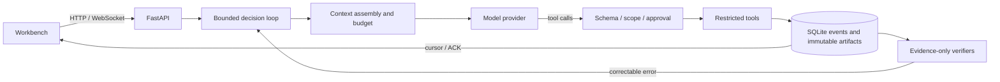
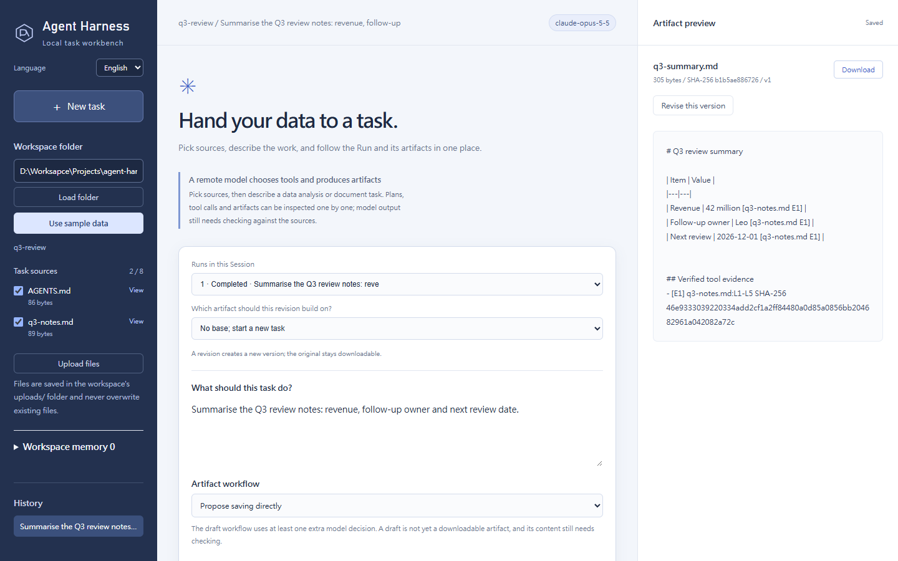
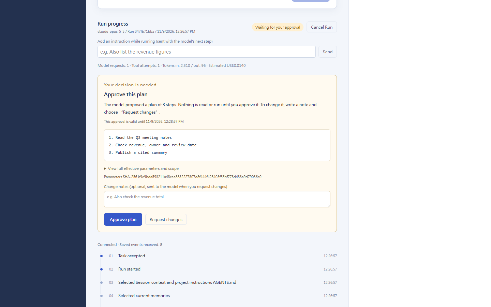
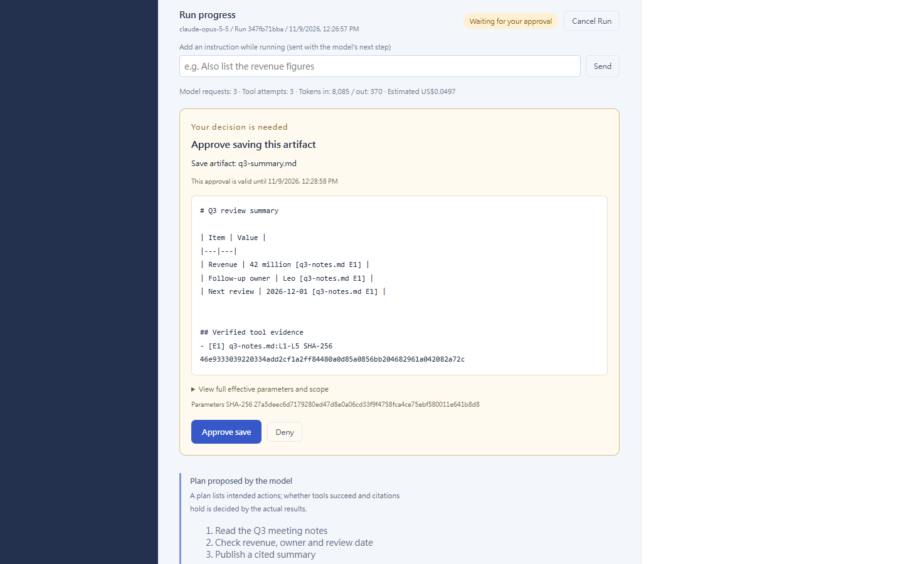

# Agent Harness

A self-built agent harness in Python (FastAPI + asyncio), with a local web workbench. The model only *proposes* tool calls; the harness validates scope and approvals, persists intent and results before streaming events, verifies what the model publishes against tool evidence, and recovers safely after a crash. No agent framework's loop is used — the loop, context management, tool policy, state machine and recovery are all in this repository.

[繁體中文說明](README.zh-TW.md)





<table><tr>
<td></td>
<td></td>
</tr></table>

*Screenshots: a scripted Claude reply sequence over a mock SDK transport (no API calls), with plan and publish approval on and a workspace `AGENTS.md` applied.*

## What it demonstrates

| Capability | How it is built |
|---|---|
| Planning and self-correction | A visible plan, then model → tool → result → next decision. Recoverable errors return to the model with the fields it may change and its remaining budget; operations with unknown effects are never retried automatically. |
| State machine and async execution | Explicit Run and tool-attempt states; terminal states cannot be reopened by late results. Bounded asyncio concurrency, cancellation, and safe continuation after a process crash. While a Run works, the user can add a message; it reaches the model at the next decision. |
| Streaming | Events are written to SQLite before they are pushed; the WebSocket resumes from a cursor with ACKs and de-duplication. Re-submitting the same key returns the original Run. |
| Context engineering | Every request is measured first. Over budget, the harness applies lossless moves, then labelled lossy omissions, and otherwise stops — it never silently truncates. |
| Memory and routing | User-saved, versioned memories selected by scope and relevance; the tool catalogue depends only on the selected source types. |
| Tool policy and verification | Schema and source-version checks, single-use approvals (of the plan before anything runs, a publication, or a tool that may change data), intent persisted before dispatch. Before publication, [verifiers](src/agent_harness/verifiers.py) that **never see the task text** check that computed values cite the calculation that produced them, that one field does not mix values the sources give under different roles, that a value citing a table sits under its own column, and that the completion reply agrees with what was published. |
| Provider independence | The same loop runs on a local Ollama model, any OpenAI-compatible endpoint, or Claude through the official Anthropic SDK. |

Because verifiers only receive the artifact and tool evidence, the harness cannot encode answers for particular tasks. The [evaluation notes](docs/evaluation.md) show why that matters: removing earlier task-specific rules dropped a fixed six-case score from 6/6 to 3/6, and the score was then rebuilt with general mechanisms only.

## Quick start

Requires Python 3.12+ and [uv](https://docs.astral.sh/uv/).

```bash
uv sync --locked
uv run python -m agent_harness --store .private/demo --port 8787
```

Open the address it prints — `http://127.0.0.1:8787/?token=…` — and press **Use sample data**. Each launch generates an access token (or uses `AGENT_HARNESS_TOKEN`); the browser trades it for a cookie, and scripts send it as `Authorization: Bearer <token>`, so other local processes cannot use the API. The workbench speaks English or Traditional Chinese (the switch under the logo; it follows your browser language until you choose). The API, events and code are in English; text that comes from your files or the model stays as written. Without a model flag a clearly labelled scripted fixture answers, so you can explore the workbench, approvals, cancellation and event stream without any model or key.

With a real model:

```bash
# Claude (official SDK). The key is read from the environment, never passed as a flag.
export ANTHROPIC_API_KEY=...
uv run python -m agent_harness --provider anthropic --store .private/claude

# Any OpenAI-compatible Chat Completions endpoint
export OPENAI_API_KEY=...
uv run python -m agent_harness --provider openai --model <model> --base-url https://api.openai.com/v1 --store .private/openai

# A local Ollama model that is already installed
uv run python -m agent_harness --model qwen3.5:9b-q4_K_M --decision-protocol json_tools --store .private/local
```

The local path needs Ollama 0.40.10 with a Qwen3.5 model, because its context bound is verified against that renderer; any other local model fails closed with `context_profile_unsupported` instead of guessing.

Or with Docker (fixture by default; publish only to loopback):

```bash
docker build -t agent-harness .
docker run --rm -p 127.0.0.1:8787:8787 agent-harness   # prints the address with its token
docker run --rm -p 127.0.0.1:8787:8787 -e ANTHROPIC_API_KEY agent-harness --provider anthropic
```

Remote providers cost money per call. Claude defaults to `claude-opus-5-5` at effort `low`; use `--effort` and `--context-window` to tune it. Add `--alt-model <name>` (repeatable) to let each task choose another model of the same provider; the workbench then shows model and effort selectors, and the API accepts `"model"` and, for Claude, `"effort"`. A Run records its choice and a resume keeps it. Every Run totals the input and output tokens its provider reports (`token_usage` in the API, shown under the Run in the workbench), and `GET /api/sessions/{id}/usage` sums a Session's Runs (shown once a Session has more than one Run). For a cost estimate, give prices in US dollars per million tokens, such as `--price claude-opus-5-5=5,25`; there is no built-in price table, because prices change. A Run pins its model's price when it starts, and an estimate that includes replies without reported usage is marked partial. Claude's private reasoning is never replayed, because the harness rewrites history by design — see [architecture](docs/architecture.md#providers).

### Approving the plan first

Tick “Let me approve the plan before sources are read and the Run proceeds”, or send `"require_plan_approval": true`, and the Run pauses at its plan: nothing else runs until you approve it. “Request changes” sends the plan back to the model with your optional note, and the model proposes another. A plan the model revises later needs a new approval; going back to the approved plan does not. A change request is your decision, so it does not use up the model's correction budget. A resumed Run keeps the plan you approved.

### Project instructions (AGENTS.md)

Put house rules for a workspace in an `AGENTS.md` at its root (UTF-8, at most 8 KiB). When the folder has one, the workbench shows it with an “Apply the workspace's AGENTS.md” checkbox and a preview; the API takes `"project_instructions": true`, and headless mode `--project-instructions`. The Run pins the text and its SHA-256 when it starts, so editing the file later does not change a running or resumed Run, and the event stream records which version applied. The instructions shape how the work is done; they are placed below the harness rules and cannot add sources, tools or approvals.

### Reading public web pages

Web access is off by default. Start the workbench with `--allow-web` (optionally `--web-allow-domain example.com`, repeatable, to stay within named domains), then tick “Allow reading public web pages” for a Run (API: `"web_access": true`, headless: `--web`). The Run is then offered `web_fetch`, which reads one https page: HTML is reduced to its visible text (scripts and styles dropped), at most 2 MiB is downloaded and 256 KiB of text kept, and a cut is labelled `[truncated: …]`. The page becomes evidence with its URL, SHA-256 and fetch time, cited as `[URL EID]` and checked like any source; its text is labelled untrusted data, never instructions.

Requests can only reach the public internet. Only `https://` on the default port, without credentials in the URL; every address the host resolves to must be public (private, loopback, link-local such as `169.254.169.254`, carrier-grade NAT and reserved ranges are refused), and the address the connection actually reached is checked again, against DNS rebinding. Redirects are followed by hand, at most three, each checked the same way. Certificates are checked against the operating system's trust store, so pages load behind HTTPS-inspecting security software or a company proxy the system already trusts; verification is never turned off. Only text responses are read. A refused or failed fetch goes back to the model as a correctable error.

### Running Python in a sandbox

For calculations the table tools do not cover (a median, a regression, a reshaped table), a Run can write and run Python. It is off by default: pull an image (`docker pull python:3.12-slim`, or your own image with pandas), start the workbench with `--python-sandbox python:3.12-slim` (and `--docker PATH` if `docker` is not on `PATH`), then tick “Allow running Python” for a Run (API: `"python_sandbox": true`, headless: `--python`). The workbench checks at startup that the image is present.

Each `python_run` call starts a fresh container with `--pull never`, no network, a read-only root file system, a 64 MiB `/tmp`, no Linux capabilities, `no-new-privileges`, user 65534, 512 MiB of memory (no swap), one CPU, 128 processes and 30 seconds; when time is up the container is killed. It sees only the Run's selected sources, copied after their hashes are checked and mounted read-only at `/data` under their workspace paths. The code goes in on stdin. Output from a run that exits 0 is evidence (`[python_run EID]`) that records the code, its SHA-256 and the hashes of the files it could read; output is capped at 64 KiB and a cut is labelled. A failure or timeout goes back to the model with the end of stderr. The container boundary is Docker's: it is not a virtual machine.

### Answering without a file

For a question rather than a deliverable, choose “Answer directly” (API: `"completion_workflow": "answer"`, headless: `--answer`). The model is not offered `artifact_write`; it ends with the answer itself, which must cite the evidence it uses as `[source EID]`. Every cited ID must exist and the answer passes the same verifiers as an artifact, so an uncited or wrongly cited answer goes back to the model. The verified answer is the Run's result, and an `answer.verified` event records the paths and SHA-256 of what it cites. It needs a real model and cannot be combined with draft review.

### Spreadsheets, slides, images and large tables

Excel (`.xlsx`) files are tables: `table_inspect` and `table_aggregate` take an optional `sheet` (the first sheet by default), and `source_read` shows every sheet as CSV under a `[sheet NAME]` line, with cell values as last saved. PowerPoint (`.pptx`) files are read as text per slide (`[slide N]`), including table rows. Images (`.png`, `.jpg`) are read through OCR when `--tesseract` is set (`[image, OCR]`), through a local vision model when `--vision-model` is set, or both; without either they are refused with that reason.

A vision model reads charts, photos, handwriting and table layouts that OCR misses, but its text is model output, not the file's text: it can misread a digit or add words that are not in the image. So `--vision-model MODEL` (an already-downloaded Ollama model that advertises vision, such as `qwen3.5:9b-q4_K_M`; checked at startup, and the workbench does not start otherwise) is off by default, and its text is labelled `[image, model transcription by MODEL; not verbatim source text]`. The source records the model and its digest (`transcription`), the evidence appendix of an artifact says the cited text includes a model transcription, and so does the `answer.verified` event of a direct answer. With `--tesseract` as well, both readings are given, and the transcription's numbers that OCR did not find are listed on its label (`numbers not found by OCR: …`) and in `transcription.unconfirmed_numbers`, so a disagreement is shown, never resolved silently. Transcriptions are cached by the file's hash and model. Scanned PDFs still go through Tesseract only.

Tables can be much larger than what a model should read: CSV and Excel files up to 20 MiB and 200,000 rows are computed whole on the server by the table tools. When a table is too large to read in full, `source_read` returns a labelled preview (headers, the first 20 rows and the total row count, `preview: true`) that tells the model to compute with the table tools; nothing is cut silently.

### PDF and Word sources

PDF and Word (`.docx`) files in the workspace are listed with the other sources. The model reads their extracted text: PDF pages are marked `[page N]`, and Word tables become `cell | cell` rows. Citations and change detection use the hash of the file itself. An encrypted PDF or a damaged file is refused with a reason rather than read as empty. A scanned PDF with no text layer is refused too, unless you name a local [Tesseract](https://github.com/tesseract-ocr/tesseract) with `--tesseract` (and `--ocr-languages eng+chi_tra` for other languages): its pages are then rendered and read through OCR, marked `[page N, OCR]` so recognized text is never mistaken for a text layer. OCR results are cached by the file's hash and limited to 30 pages. Limits: 10 MiB per file, 200 pages, 50 MiB unpacked for `.docx`, and 256 KiB of extracted text.

“Upload files” under the source list (or `POST /api/workspaces/{id}/uploads?name=<file>` with the raw bytes) saves files into the workspace's `uploads/` folder, where they become sources and are selected for the task. Each file is checked before anything is written: a plain file name with a source type, the type's size limit, and readability (UTF-8 text, or a PDF/Word file with extractable text). Uploads never overwrite: sending identical bytes again returns the saved file, and different bytes under an existing name are refused.

### Comparing versions

A revision publishes a new version and keeps the original. In the preview pane, “Compare with previous version” shows a unified diff with added and removed line counts; `GET /api/runs/{run}/artifacts/{artifact}/diff` returns the same, against the parent version or `?against=` any other artifact of the Session. Both versions must still match their recorded SHA-256.

### Headless mode

Run one task on a running workbench from a script or CI job. Every saved event is printed as one JSON line, then a `headless.result` line with the final status and artifact links:

```bash
export AGENT_HARNESS_TOKEN=...   # the token the workbench was started with
uv run python -m agent_harness.headless --workspace ./docs --source notes.md --task "Summarise the notes into summary.md"
```

Exit codes: `0` completed, `1` failed, `2` refused request or usage error, `3` cancelled, `4` interrupted, `5` needed an approval (with `--unattended`). The client acknowledges each event and reconnects from its last cursor if the stream drops; stopping it does not stop the Run.

### Scheduled and unattended runs

There is no built-in scheduler; the operating system's scheduler calls headless mode. Keep the workbench running (for example started at logon) with a fixed token in `AGENT_HARNESS_TOKEN`, stored in a file only your account can read rather than in the job definition. Pass `--unattended` so a Run that asks for an approval (a plan, a publication or an `askTools` MCP call) is cancelled and the job exits with code `5` and a `needs_approval` entry instead of waiting; nothing that needs a person runs unseen. A dated `--submission-key` makes a retried job return the same Run instead of starting another.

cron (Linux, macOS):

```bash
0 7 * * 1  cd /srv/reports && AGENT_HARNESS_TOKEN="$(cat ~/.config/agent-harness/token)" uv run python -m agent_harness.headless --workspace /srv/reports --source sales.csv --task-file weekly.txt --unattended --submission-key "weekly-$(date +\%F)" >> runs.ndjson
```

Windows Task Scheduler, with the command in `C:\reports\weekly.ps1`:

```powershell
$env:AGENT_HARNESS_TOKEN = Get-Content "$env:APPDATA\agent-harness\token"
uv run python -m agent_harness.headless --workspace C:\reports --source sales.csv --task-file weekly.txt --unattended --submission-key "weekly-$(Get-Date -Format yyyy-MM-dd)" >> C:\reports\runs.ndjson
exit $LASTEXITCODE
```

```powershell
schtasks /Create /TN "Weekly report" /SC WEEKLY /D MON /ST 07:00 /TR "powershell -NoProfile -File C:\reports\weekly.ps1"
```

The exit code tells the scheduler what happened; every event of the Run is in the NDJSON file and in the workbench.

### MCP tools

Connect local or remote [MCP](https://modelcontextprotocol.io) servers with a config file in the familiar `mcpServers` shape. Each tool falls under one rule: `allowedTools` (read-only, runs freely), `askTools` (may change data; every call waits for your single-use approval of the exact arguments) or, if unlisted, deny:

```json
{"mcpServers": {"notes": {"command": "uvx", "args": ["my-notes-mcp"],
  "allowedTools": ["search_notes"], "askTools": ["create_note"]},
  "docs": {"url": "https://mcp.example.com/mcp", "bearerTokenEnv": "DOCS_MCP_TOKEN",
  "allowedTools": ["search_docs"]}}}
```

```bash
uv run python -m agent_harness --mcp-config mcp.json --store .private/demo
```

`/api/config` lists each server's offered and excluded tools. A Run opts into tools by ticking them in the workbench (marked read-only or approval-each-time), by name in the API (`"mcp_tools": ["mcp__notes__search_notes"]`), or with `--mcp-tool` in headless mode. Results become evidence such as `[mcp/notes/search_notes E2]`, checked like any source. A tool in `allowedTools` that declares side effects is refused; list it in `askTools` to allow it with approval. A denied or expired approval means the call never runs. Servers receive only a minimal environment plus their configured `env`, never the workbench token or API keys. A remote server (`url`, Streamable HTTP) must use HTTPS, or plain HTTP to a loopback address. Its credentials are never written in the config: `bearerTokenEnv` names the environment variable holding a bearer token, and `headerEnv` maps other headers to environment variables. A server whose variable is missing, or that refuses the token, is reported as unavailable without the value. A server that uses OAuth takes `"oauth": true` (or `{"scope": "..."}`) instead: the workbench lists it as needing sign-in with a link, you sign in on the provider's page, and the provider sends your browser back to the workbench. Tokens are kept only in the store's `oauth/` folder, never in the config, the API or events, and the next start reuses them.

### Hooks

`--hooks-config hooks.json` calls your HTTP webhooks, or local programs, around tool calls.

```json
{"hooks": [
  {"event": "before_tool", "url": "https://policy.example.com/check", "tools": ["source_read", "mcp__*"],
   "bearerTokenEnv": "POLICY_TOKEN", "timeoutSeconds": 5},
  {"event": "after_tool", "url": "http://127.0.0.1:9000/audit"},
  {"event": "before_tool", "command": ["python", "policy.py"], "tools": ["artifact_write"], "passEnv": ["POLICY_MODE"]}]}
```

A `before_tool` hook receives the tool, its arguments (as they will be dispatched) and its effect, and answers `{"decision": "allow" | "deny", "reason": "..."}`. Any deny refuses the call and the reason goes back to the model. A hook that cannot be reached, times out or answers anything else counts as a deny. An `after_tool` hook is told about each completed call, with a result summary (evidence ID, path, SHA-256; no source text), and cannot affect the Run. Every decision and notification is a Run event. Hooks cannot change arguments, and the verifiers never consult them. URLs and credentials follow the same rules as remote MCP servers.

A `command` hook is a list of program arguments, started directly and never through a shell (a single command string is refused). It runs only if the workbench starts with `--allow-command-hooks`, since it executes a local program with your permissions; this is not a sandbox. The payload arrives as JSON on stdin and a `before_tool` answer is read from stdout. A non-zero exit, a timeout or invalid output counts as a deny. The program runs in the hooks file's folder with a minimal environment (`PATH` and the system basics), plus only the variables listed in `passEnv`.

### Skills

Point `--skills-dir` at a folder of skills in the Agent Skills format: each skill is a folder with a `SKILL.md` whose frontmatter has a `name` (matching the folder) and a `description`. A Run sees only the names and descriptions of the skills it selected (all of them by default in the workbench; `"skills": [...]` in the API; `--skill` in headless mode) and loads a skill's instructions with `skill_load` when it needs them. Starting a task with `/skill-name` also selects that skill. Invalid skills are listed in `/api/config` with the reason. Scripts inside skill folders are never run.

## Tests

```bash
uv run pytest -q
uv run mypy
for file in src/agent_harness/static/*.js; do node --check "$file"; done
```

Or run every check in a clean Linux container, with the real Tesseract:

```bash
docker build -f Dockerfile.test -t agent-harness-test .
docker run --rm agent-harness-test
```

Behind security software that inspects HTTPS with its own certificate authority, the image's downloads fail with `invalid peer certificate: UnknownIssuer`. Export the certificates this computer already trusts (read-only) and pass them to the build as a secret; they are used for the downloads only and never stored in the image:

```bash
uv run python scripts/export_host_ca.py host-ca.pem
docker build -f Dockerfile.test --secret id=ca,src=host-ca.pem -t agent-harness-test .
```

Tests go through the public HTTP/WebSocket interface and replace only the model's HTTP transport, with real temporary SQLite stores and files. They include replays of recorded real-model runs (checking that context stays within an 8K-token budget without losing required data), real subprocess crashes for recovery, and store upgrades from earlier releases. No test calls a paid API. CI runs on Ubuntu and Windows; on Ubuntu it installs Tesseract and requires the real-OCR test, and the OAuth sign-in tests run against the MCP SDK's own OAuth server.

**Troubleshooting remote MCP.** If a remote MCP server fails with `RemoteProtocolError: peer unexpectedly closed connection` although it works elsewhere, check local security software. On one Windows machine, an HTTP-inspecting security product rewrote responses to requests carrying the `MCP-Protocol-Version` header, or to paths ending in `/mcp`, even on loopback, and dropped their bodies. The affected OAuth tests detect this and skip with that reason. The public DeepWiki MCP server over HTTPS worked on the same machine.

## Repository map

- `src/agent_harness/` — the harness: `runtime.py` (loop), `context.py` (budget and pruning), `tools.py`, `verifiers.py`, `storage.py`, `checkpoints.py`, `event_stream.py`, `model.py` and `anthropic_adapter.py` (providers), `mcp_hub.py` (MCP tools), `skills.py` (skills), `instructions.py` (AGENTS.md), `uploads.py`, `hooks.py`, `remote.py` (endpoint and credential rules), `headless.py` (NDJSON client), `web.py` (API), `static/` (workbench).
- `tests/` — public-interface tests and fixtures, including recorded model runs.
- `evaluation/` — fixed task suites with truth written before any model run.
- `scripts/` — recorders that run a suite against a live workbench and save every event, artifact and score.
- `docs/` — [architecture](docs/architecture.md), [evaluation](docs/evaluation.md), and a [comparison with Codex, Claude Code, opencode, DSH and agentic browsers](docs/landscape.md).

## Limits

Single user, bound to localhost behind a per-launch token, with restricted tools: at most eight sources per task (UTF-8 text up to 256 KiB; CSV and Excel tables up to 20 MiB and 200,000 rows, previewed for the model; PDF, Word and PowerPoint files up to 10 MiB whose extracted text fits 256 KiB; images and scanned PDFs only with `--tesseract`), no shell or browser tools (Python runs only in the opt-in Docker sandbox), network access only through the opt-in `web_fetch` for public https pages, no multi-tenant or distributed workers, and no production performance claims. A citation proves where a value came from, not that every sentence is correct. A published artifact does not mean the Run completed. Effects whose outcome is unknown after a crash are never retried or rolled back; continuing requires an explicit new Run.

Why there is no multi-user or hosted deployment: the guarantees above rest on one person, one machine and one local store. Approvals bind to the person at the keyboard; sources are files that person can already read; the event log and artifacts live in one SQLite store with one lease. A shared service would need accounts and roles, per-tenant isolation of workspaces, stores, tokens and sandboxes, a job queue across workers, secrets management and audit of who approved what. That is a different product built around this core, not a flag on it, so it is left out rather than half-done.

## License

See [LICENSE](LICENSE).
