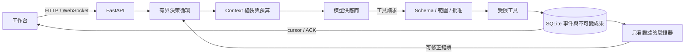
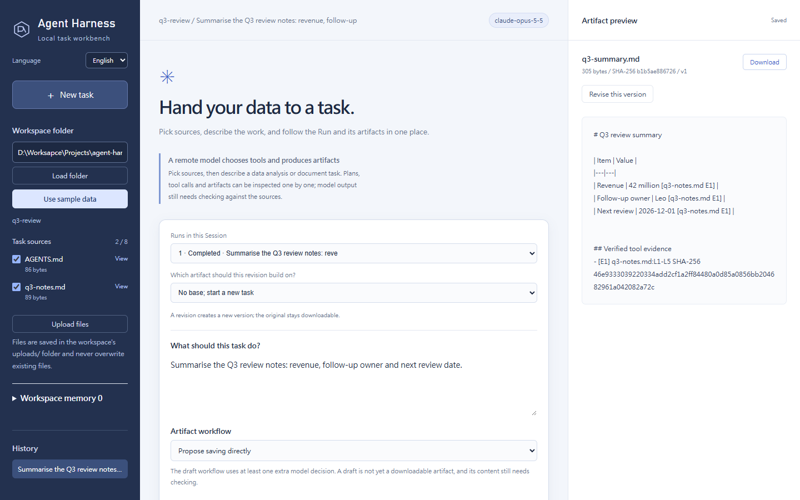
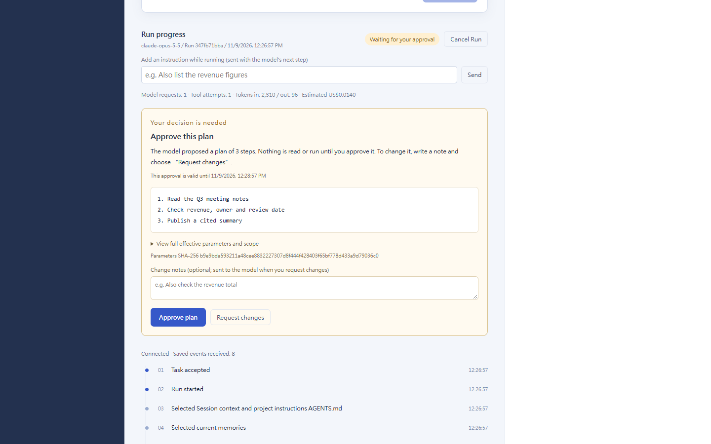
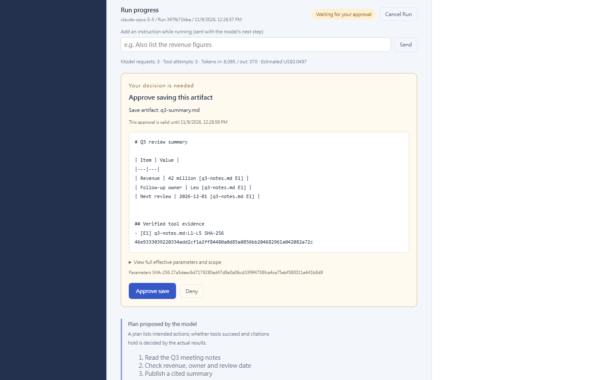

# Agent Harness

以 Python（FastAPI＋asyncio）自建的 agent harness，附本機網頁工作台。模型只**提出**工具請求；harness 負責驗證範圍與批准、先保存意圖與結果再串流事件、用工具證據檢查模型發布的內容，並在程序中斷後安全續做。沒有使用任何 agent 框架的決策循環：循環、Context 管理、工具政策、狀態機與恢復機制都在這個 repo 裡。

[English](README.md)





<table><tr>
<td></td>
<td></td>
</tr></table>

*截圖使用英文介面（左上角可切換為繁中），以模擬的 Claude 回覆經 mock SDK 傳輸產生（沒有呼叫 API），並開啟計畫與發布核准、套用工作區 `AGENTS.md`。*

## 可以展示什麼

| 能力 | 實作重點 |
|---|---|
| 規劃與自我修正 | 可見計畫，模型→工具→結果→下一步。可修正錯誤帶著可改的欄位與剩餘預算回饋給模型；效果未知的操作不自動重送。 |
| 狀態機與非同步 | Run 與工具嘗試的明確狀態，終態不會被晚到的結果重開；asyncio 有界並行、取消，以及程序中斷後的安全續做。Run 執行中可追加訊息，在模型的下一次決策送達。 |
| 即時串流 | 事件先寫入 SQLite 再推送；WebSocket 以 cursor／ACK 補讀與去重；相同提交 key 回到原 Run。 |
| Context 工程 | 每次請求先計量；超出預算時依序做無損搬移、標明的有損省略，仍超出就明確停止，不默默截斷。 |
| 記憶與 Routing | 使用者明確保存的版本化記憶，依作用範圍與相關性選入；工具目錄只依來源類型提供。 |
| 工具政策與驗證 | Schema 與來源版本驗證、單次操作批准（執行前核准計畫、發布成果、可能變更資料的工具）、派發前先保存意圖。發布前由**拿不到任務文字**的[驗證器](src/agent_harness_demo/verifiers.py)檢查：計算值是否引用產生它的計算、同一欄位是否混放不同來源角色的值、完成回覆是否與已發布成果一致。 |
| 不綁定供應商 | 同一個循環可跑本機 Ollama 模型、任何 OpenAI 相容端點，或透過官方 Anthropic SDK 的 Claude。 |

驗證器只拿得到成果與工具證據，所以 harness 無法為特定題目寫答案規則。[評估紀錄](docs/evaluation.md)說明了這為什麼重要：移除早期針對案例的規則後，固定六例從 6/6 掉到 3/6，之後只用通用機制重新拉回。

## 快速開始

需要 Python 3.12 以上與 [uv](https://docs.astral.sh/uv/)。

```bash
uv sync --locked
uv run python -m agent_harness_demo --store .private/demo --port 8787
```

開啟它印出的網址（`http://127.0.0.1:8787/?token=…`），按「使用範例資料」。工作台介面提供英文與繁體中文（標誌下方的切換選單；在你選擇之前依瀏覽器語言決定），來自檔案或模型的文字則維持原文。每次啟動都會產生存取權杖（或使用 `AGENT_HARNESS_TOKEN`）；瀏覽器會把它換成 cookie，腳本則以 `Authorization: Bearer <token>` 送出，同機的其他程序無法使用 API。不指定模型時由清楚標示的固定腳本回應，不需要任何模型或 API key 就能操作工作台、批准、取消與事件串流。

使用真實模型：

```bash
# Claude（官方 SDK）。API key 從環境變數讀取，不會出現在指令參數。
export ANTHROPIC_API_KEY=...
uv run python -m agent_harness_demo --provider anthropic --store .private/claude

# 任何 OpenAI 相容的 Chat Completions 端點
export OPENAI_API_KEY=...
uv run python -m agent_harness_demo --provider openai --model <model> --base-url https://api.openai.com/v1 --store .private/openai

# 已安裝的本機 Ollama 模型
uv run python -m agent_harness_demo --model qwen3.5:9b-q4_K_M --decision-protocol json_tools --store .private/local
```

本機路徑需要 Ollama 0.40.10 搭配 Qwen3.5 模型，因為 Context 上限只針對該 renderer 驗證過；其他本機模型會以 `context_profile_unsupported` 直接拒絕，而不是猜測。

或使用 Docker（預設是固定腳本，只發布到 loopback）：

```bash
docker build -t agent-harness .
docker run --rm -p 127.0.0.1:8787:8787 agent-harness   # 會印出含權杖的網址
docker run --rm -p 127.0.0.1:8787:8787 -e ANTHROPIC_API_KEY agent-harness --provider anthropic
```

遠端模型依呼叫計費。Claude 預設 `claude-opus-5-5`、effort `low`，可用 `--effort` 與 `--context-window` 調整。加上 `--alt-model <名稱>`（可重複）後，每個任務都能改用同一供應商的其他模型；工作台會顯示模型與思考強度選單，API 接受 `"model"`，Claude 另可指定 `"effort"`。Run 會記錄所選設定，續做時保留。每個 Run 都會加總供應商回報的輸入與輸出 tokens（API 的 `token_usage`，工作台顯示在 Run 下方）；`GET /api/sessions/{id}/usage` 會加總同一對話的所有 Run（對話有兩次以上執行時顯示在工作台）。若要估算費用，請以每百萬 tokens 的美元單價設定，例如 `--price claude-opus-5-5=5,25`；專案沒有內建價格表，因為價格會變動。Run 開始時會固定所用模型的單價；若有回覆未回報用量，估算會標示為不完整。因為 harness 會刻意改寫歷史，Claude 的私密推理不會被重送，詳見[架構](docs/architecture.zh-TW.md)。

### 先核准計畫再執行

勾選「先讓我核准計畫，再開始讀取來源與執行」，或在 API 送出 `"require_plan_approval": true`，Run 會停在計畫這一步：你核准之前，其他工具都不會執行。按「要求修改」會把計畫連同你的修改意見（選填）退回模型，由模型重新提出。之後模型若修改計畫，需要再次核准；改回已核准的計畫則不需要。要求修改是你的決定，因此不會消耗模型的錯誤修正額度。續做的 Run 會保留你核准過的計畫。

### 專案指令（AGENTS.md）

把工作區的固定做法寫在根目錄的 `AGENTS.md`（UTF-8，最多 8 KiB）。資料夾有這個檔案時，工作台會顯示「套用工作區的 AGENTS.md」勾選框與內容預覽；API 使用 `"project_instructions": true`，無頭模式用 `--project-instructions`。Run 開始時會固定記錄這份文字與 SHA-256，之後修改檔案不會影響執行中或續做的 Run，事件串流也會記錄套用的是哪個版本。這些指令只調整做法，放在 harness 規則之下，不能增加來源、工具或批准。

### PDF 與 Word 來源

工作區中的 PDF 與 Word（`.docx`）檔會和其他來源一起列出。模型讀到的是擷取出的文字：PDF 每頁標上 `[page N]`，Word 表格轉成 `儲存格 | 儲存格` 的列。引用與變更偵測使用檔案本身的雜湊。沒有文字層的掃描 PDF、加密 PDF 或損壞的檔案會附上原因拒絕，不會當成空白讀取。限制：每個檔案 10 MiB、200 頁、`.docx` 解壓後 50 MiB、擷取文字 256 KiB。

來源清單下方的「上傳檔案」（或以原始位元組呼叫 `POST /api/workspaces/{id}/uploads?name=<檔名>`）會把檔案存進工作資料夾的 `uploads/`，成為來源並自動勾選。寫入前會先檢查：不含資料夾的檔名與來源類型、該類型的大小上限，以及能否讀取（UTF-8 文字，或有可擷取文字的 PDF／Word）。上傳不會覆寫：再次送出相同內容會回傳已保存的檔案，同名但內容不同則拒絕。

### 比較版本

修改會發布新版本並保留原稿。在預覽窗格按「與上一版比較」，會顯示統一差異格式與新增、刪除的行數；`GET /api/runs/{run}/artifacts/{artifact}/diff` 回傳相同內容，預設對照上一版，也可用 `?against=` 指定同一對話中的其他成果。兩個版本都必須仍符合記錄的 SHA-256。

### 無頭模式

從腳本或 CI 對執行中的工作台跑一個任務。每個已保存事件輸出成一行 JSON，最後一行 `headless.result` 附上終止狀態與成果連結：

```bash
export AGENT_HARNESS_TOKEN=...   # 工作台啟動時使用的權杖
uv run python -m agent_harness_demo.headless --workspace ./docs --source notes.md --task "把筆記整理成 summary.md"
```

退出碼：`0` 完成、`1` 失敗、`2` 請求被拒或用法錯誤、`3` 已取消、`4` 已中斷。用戶端逐筆確認事件，串流中斷時從上次的 cursor 重新接上；結束用戶端不會停止 Run。

### MCP 工具

用 `mcpServers` 格式的設定檔連接本機 [MCP](https://modelcontextprotocol.io) 伺服器。每個工具只屬於一條規則：`allowedTools`（唯讀，可直接執行）、`askTools`（可能變更資料，每次呼叫都要等你對確切參數做單次核准），或未列出即拒絕：

```json
{"mcpServers": {"notes": {"command": "uvx", "args": ["my-notes-mcp"],
  "allowedTools": ["search_notes"], "askTools": ["create_note"]}}}
```

```bash
uv run python -m agent_harness_demo --mcp-config mcp.json --store .private/demo
```

`/api/config` 會列出每個伺服器提供與排除的工具。Run 可在工作台勾選工具（標示唯讀或每次需核准），也可在 API 依名稱選用（`"mcp_tools": ["mcp__notes__search_notes"]`），無頭模式用 `--mcp-tool`。結果會成為像 `[mcp/notes/search_notes E2]` 的證據，和來源一樣受檢查。列在 `allowedTools` 的工具若自行宣告有副作用會被拒絕；改列在 `askTools` 才能在核准後使用。核准被拒或過期時，該呼叫永遠不會執行。伺服器只會收到最小的環境變數加上設定中的 `env`，不會拿到工作台權杖或 API 金鑰。目前只支援本機 stdio 伺服器。

### Skills

用 `--skills-dir` 指向 Agent Skills 格式的 skills 資料夾：每個 skill 是一個含 `SKILL.md` 的資料夾，frontmatter 寫明 `name`（須與資料夾同名）與 `description`。Run 只會看到所選 skills 的名稱與說明（工作台預設全選；API 用 `"skills": [...]`；無頭模式用 `--skill`），需要時才以 `skill_load` 載入完整指示。任務以 `/skill名稱` 開頭也會選用該 skill。無效的 skill 會連同原因列在 `/api/config`。skill 資料夾裡的腳本永遠不會執行。

## 測試

```bash
uv run pytest -q
uv run mypy
for file in src/agent_harness_demo/static/*.js; do node --check "$file"; done
```

測試只走公開的 HTTP／WebSocket 介面，並只替換模型的 HTTP transport，使用真實的暫存 SQLite 與檔案。內容包括真實模型錄製紀錄的回放（確認 Context 在 8K token 內不遺失必要資料）、真子程序中斷後的恢復，以及從舊版本升級資料。沒有任何測試會呼叫付費 API。CI 在 Ubuntu 與 Windows 上執行。

## 目錄

- `src/agent_harness_demo/`：harness 本體。`runtime.py`（循環）、`context.py`（預算與裁切）、`tools.py`、`verifiers.py`、`storage.py`、`checkpoints.py`、`event_stream.py`、`model.py` 與 `anthropic_adapter.py`（供應商）、`mcp_hub.py`（MCP 工具）、`skills.py`（Skills）、`instructions.py`（AGENTS.md）、`headless.py`（NDJSON 用戶端）、`web.py`（API）、`static/`（工作台）。
- `tests/`：公開介面測試與 fixtures，包含錄製的模型執行紀錄。
- `evaluation/`：固定題組，真值在任何模型執行前寫定。
- `scripts/`：對執行中的工作台跑題組，保存每個事件、成果與評分的記錄器。
- `docs/`：[架構](docs/architecture.zh-TW.md)、[評估](docs/evaluation.md)，以及[與 Codex、Claude Code、opencode、DSH 和代理瀏覽器的比較](docs/landscape.zh-TW.md)。

## 限制

單一使用者、只綁定 localhost 並需每次啟動的權杖、受限工具：每個任務最多八份來源（UTF-8 文字每份 256 KiB，或 PDF、Word 檔每份 10 MiB 且擷取文字不超過 256 KiB；不做 OCR）；沒有 shell、瀏覽器或網路工具，沒有多租戶或分散式 worker，也不宣稱正式環境的效能。引用能證明數值來源，不代表每句話都正確。已發布成果不等於整個 Run 完成。中斷時效果未知的操作不會自動重送或回滾，續做必須明確建立新 Run。

## 授權

見 [LICENSE](LICENSE)。
