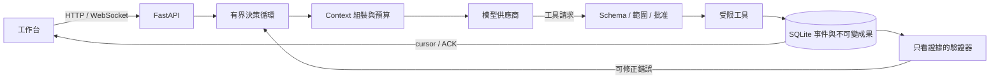

# Agent Harness

以 Python（FastAPI＋asyncio）自建的 agent harness，附本機網頁工作台。模型只**提出**工具請求；harness 負責驗證範圍與批准、先保存意圖與結果再串流事件、用工具證據檢查模型發布的內容，並在程序中斷後安全續做。沒有使用任何 agent 框架的決策循環：循環、Context 管理、工具政策、狀態機與恢復機制都在這個 repo 裡。

[English](README.md)



## 可以展示什麼

| 能力 | 實作重點 |
|---|---|
| 規劃與自我修正 | 可見計畫，模型→工具→結果→下一步。可修正錯誤帶著可改的欄位與剩餘預算回饋給模型；效果未知的操作不自動重送。 |
| 狀態機與非同步 | Run 與工具嘗試的明確狀態，終態不會被晚到的結果重開；asyncio 有界並行、取消，以及程序中斷後的安全續做。Run 執行中可追加訊息，在模型的下一次決策送達。 |
| 即時串流 | 事件先寫入 SQLite 再推送；WebSocket 以 cursor／ACK 補讀與去重；相同提交 key 回到原 Run。 |
| Context 工程 | 每次請求先計量；超出預算時依序做無損搬移、標明的有損省略，仍超出就明確停止，不默默截斷。 |
| 記憶與 Routing | 使用者明確保存的版本化記憶，依作用範圍與相關性選入；工具目錄只依來源類型提供。 |
| 工具政策與驗證 | Schema 與來源版本驗證、單次操作批准、派發前先保存意圖。發布前由**拿不到任務文字**的[驗證器](src/agent_harness_demo/verifiers.py)檢查：計算值是否引用產生它的計算、同一欄位是否混放不同來源角色的值、完成回覆是否與已發布成果一致。 |
| 不綁定供應商 | 同一個循環可跑本機 Ollama 模型、任何 OpenAI 相容端點，或透過官方 Anthropic SDK 的 Claude。 |

驗證器只拿得到成果與工具證據，所以 harness 無法為特定題目寫答案規則。[評估紀錄](docs/evaluation.md)說明了這為什麼重要：移除早期針對案例的規則後，固定六例從 6/6 掉到 3/6，之後只用通用機制重新拉回。

## 快速開始

需要 Python 3.12 以上與 [uv](https://docs.astral.sh/uv/)。

```bash
uv sync --locked
uv run python -m agent_harness_demo --store .private/demo --port 8787
```

開啟它印出的網址（`http://127.0.0.1:8787/?token=…`），按「使用範例資料」。每次啟動都會產生存取權杖（或使用 `AGENT_HARNESS_TOKEN`）；瀏覽器會把它換成 cookie，腳本則以 `Authorization: Bearer <token>` 送出，同機的其他程序無法使用 API。不指定模型時由清楚標示的固定腳本回應，不需要任何模型或 API key 就能操作工作台、批准、取消與事件串流。

使用真實模型：

```bash
# Claude（官方 SDK）。API key 從環境變數讀取，不會出現在指令參數。
export ANTHROPIC_API_KEY=...
uv run python -m agent_harness_demo --provider anthropic --store .private/claude

# 任何 OpenAI 相容的 Chat Completions 端點
export OPENAI_API_KEY=...
uv run python -m agent_harness_demo --provider openai --model <model> --base-url https://api.openai.com/v1 --store .private/openai

# 已安裝的本機 Ollama 模型
uv run python -m agent_harness_demo --model qwen3.5:9b-q4_K_M --decision-protocol json_tools --store .private/local
```

本機路徑需要 Ollama 0.40.10 搭配 Qwen3.5 模型，因為 Context 上限只針對該 renderer 驗證過；其他本機模型會以 `context_profile_unsupported` 直接拒絕，而不是猜測。

或使用 Docker（預設是固定腳本，只發布到 loopback）：

```bash
docker build -t agent-harness .
docker run --rm -p 127.0.0.1:8787:8787 agent-harness   # 會印出含權杖的網址
docker run --rm -p 127.0.0.1:8787:8787 -e ANTHROPIC_API_KEY agent-harness --provider anthropic
```

遠端模型依呼叫計費。Claude 預設 `claude-opus-5-5`、effort `low`，可用 `--effort` 與 `--context-window` 調整。因為 harness 會刻意改寫歷史，Claude 的私密推理不會被重送，詳見[架構](docs/architecture.zh-TW.md)。

### 無頭模式

從腳本或 CI 對執行中的工作台跑一個任務。每個已保存事件輸出成一行 JSON，最後一行 `headless.result` 附上終止狀態與成果連結：

```bash
export AGENT_HARNESS_TOKEN=...   # 工作台啟動時使用的權杖
uv run python -m agent_harness_demo.headless --workspace ./docs --source notes.md --task "把筆記整理成 summary.md"
```

退出碼：`0` 完成、`1` 失敗、`2` 請求被拒或用法錯誤、`3` 已取消、`4` 已中斷。用戶端逐筆確認事件，串流中斷時從上次的 cursor 重新接上；結束用戶端不會停止 Run。

### MCP 工具

用 `mcpServers` 格式的設定檔連接本機 [MCP](https://modelcontextprotocol.io) 伺服器。每個工具只屬於一條規則：`allowedTools`（唯讀，可直接執行）、`askTools`（可能變更資料，每次呼叫都要等你對確切參數做單次核准），或未列出即拒絕：

```json
{"mcpServers": {"notes": {"command": "uvx", "args": ["my-notes-mcp"],
  "allowedTools": ["search_notes"], "askTools": ["create_note"]}}}
```

```bash
uv run python -m agent_harness_demo --mcp-config mcp.json --store .private/demo
```

`/api/config` 會列出每個伺服器提供與排除的工具。Run 依名稱選用工具（`"mcp_tools": ["mcp__notes__search_notes"]`，無頭模式用 `--mcp-tool`）。結果會成為像 `[mcp/notes/search_notes E2]` 的證據，和來源一樣受檢查。列在 `allowedTools` 的工具若自行宣告有副作用會被拒絕；改列在 `askTools` 才能在核准後使用。核准被拒或過期時，該呼叫永遠不會執行。伺服器只會收到最小的環境變數加上設定中的 `env`，不會拿到工作台權杖或 API 金鑰。目前只支援本機 stdio 伺服器。

## 測試

```bash
uv run pytest -q
uv run mypy
for file in src/agent_harness_demo/static/*.js; do node --check "$file"; done
```

測試只走公開的 HTTP／WebSocket 介面，並只替換模型的 HTTP transport，使用真實的暫存 SQLite 與檔案。內容包括真實模型錄製紀錄的回放（確認 Context 在 8K token 內不遺失必要資料）、真子程序中斷後的恢復，以及從舊版本升級資料。沒有任何測試會呼叫付費 API。CI 在 Ubuntu 與 Windows 上執行。

## 目錄

- `src/agent_harness_demo/`：harness 本體。`runtime.py`（循環）、`context.py`（預算與裁切）、`tools.py`、`verifiers.py`、`storage.py`、`checkpoints.py`、`event_stream.py`、`model.py` 與 `anthropic_adapter.py`（供應商）、`mcp_hub.py`（MCP 工具）、`headless.py`（NDJSON 用戶端）、`web.py`（API）、`static/`（工作台）。
- `tests/`：公開介面測試與 fixtures，包含錄製的模型執行紀錄。
- `evaluation/`：固定題組，真值在任何模型執行前寫定。
- `scripts/`：對執行中的工作台跑題組，保存每個事件、成果與評分的記錄器。
- `docs/`：[架構](docs/architecture.zh-TW.md)、[評估](docs/evaluation.md)，以及[與 Codex、Claude Code、opencode、DSH 和代理瀏覽器的比較](docs/landscape.zh-TW.md)。

## 限制

單一使用者、只綁定 localhost 並需每次啟動的權杖、受限工具：每個任務最多八份 UTF-8 來源、每份 256 KiB；沒有 shell、瀏覽器或網路工具，沒有多租戶或分散式 worker，也不宣稱正式環境的效能。引用能證明數值來源，不代表每句話都正確。已發布成果不等於整個 Run 完成。中斷時效果未知的操作不會自動重送或回滾，續做必須明確建立新 Run。

## 授權

見 [LICENSE](LICENSE)。
