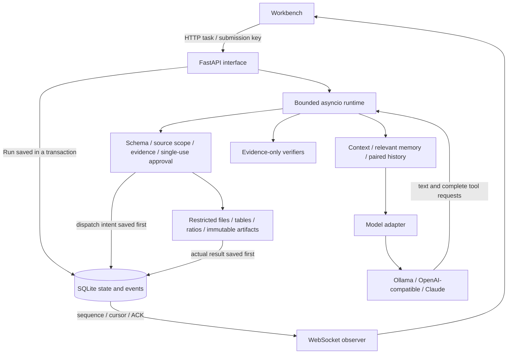

# Architecture

[繁體中文](architecture.zh-TW.md)

One runtime serves every task. Data analysis and document indexing differ only in the sources selected and in the model's own tool choices; nothing in the runtime selects a fixed runner or answer from the task text. The model adapter only translates protocols, the context builder selects bounded background, tools validate and execute capabilities, and the store persists state and events. The scripted fixture replaces only the model's transport.

## From a task to the next decision

`web.py` accepts a task with its sources and limits and saves the Run before the runtime starts. Each Session has at most one active Run; a semaphore bounds concurrency across Sessions, and blocking file and SQLite work runs in threads. A dropped WebSocket does not stop the work.

Until a plan is saved the model is offered only `plan_update`. Afterwards the catalogue depends only on Run state — the selected source types, whether there is a base artifact or a staged draft, whether something was published, whether a correction is pending — never on the task text. The catalogue is enforced: after the executor's own checks (schema, scope, evidence, review and completion gates, each with its specific error), a call to a tool the request did not offer is refused before dispatch with a correctable `tool_not_offered`. The JSON-tools protocol already rejects such names while decoding. Each `model.requested` event records the offered tool names and a SHA-256 of the exact request body.

Each step assembles the real model request and checks it against a conservative context bound before sending it. Complete history turns, source excerpts and relevant memory versions are selected by rule. Over budget, the runtime applies these moves in order, re-measuring after each one and recording it as a `context.pruned` event with its reason:

1. Drop the oldest complete history turns from earlier Runs, then the optional source excerpts.
2. Drop the model's narration next to successful tool groups (call arguments and results stay; the narration remains in events and the UI).
3. Remove tool errors that a later call already corrected or superseded.
4. Move tool groups the model has already read into an exact evidence snapshot that keeps every evidence ID and result field; identical shared source fields are stored once and restored field by field. The newest unread group, error groups and publication groups are protected.
5. Shorten the prompt-side catalogue: tool descriptions, then schema bounds (lengths, item counts, patterns), runtime guidance, inspection hints and artifact-name descriptions. The executor still enforces the full schemas. Tool names, parameter names and types, and system rules are never changed.
6. Re-encode without loss: drafts and repeated plans by reference (review and receipt modes), and, after publication, the labelled-line view already contained in a source's text and the whitespace in tool-result JSON.
7. If the request still does not fit, stop with `context_limit_exceeded`.

Steps 1, 2 and 5 lose information and are recorded as such; the context as a whole is not claimed to be lossless.

The adapter normalises text and tool requests and never executes a streamed call whose arguments are incomplete. `Tools.prepare` validates the schema, workspace scope and evidence references and produces the effective arguments. When approval is required, the exact pending operation and its digest are stored and the run waits; an approval applies once, to that Run, call and argument set. The dispatch intent is persisted before the tool runs. The real result goes back to the model, which chooses the next step. Correctable errors carry the remaining budget and `correctable_fields`; operations with unknown effects are not retried.

Artifacts are stored with an immutable identity, SHA-256 and exact bytes. A revision pins its completed base and adds a version instead of overwriting. Any two versions in a Session can be compared as a unified diff (by default a version against its parent); both are re-hashed before comparing, and only the first two diff lines are file headers, so a removed `---` rule still counts as a removed line.

Tables are read two ways. `read_source` is what the model sees: a CSV, or every sheet of an `.xlsx` workbook as CSV (openpyxl, cached values), in full when it fits the 256 KiB source budget and otherwise as a preview labelled with the row count and `preview: true`. `read_table` is what the table tools compute over: the whole CSV or one named sheet, up to 20 MiB and 200,000 rows, checked against the admitted SHA-256. The `sheet` parameter is offered to the model only when a workbook is selected, so CSV-only requests are unchanged; a sheet on a CSV, or an unknown sheet, is a correctable error. `.pptx` files are read per slide with python-pptx, and images go through the same OCR program as scanned PDFs. Office files are zip archives, so all of them share the unpacked-size limit.

PDF and Word files are sources in `sources.py`: `read_source` keeps the SHA-256 and size of the file's bytes (so admission, excerpts and reads detect a changed document like any changed source) and returns extracted text for the model. `pypdf` reads PDFs page by page with `[page N]` markers; `python-docx` reads `.docx` paragraphs and tables in document order. Extraction is bounded before and during parsing (10 MiB file, 200 pages, 50 MiB unpacked archive, 256 KiB of text), and an encrypted, scanned or damaged document is refused with `source_unavailable` and a reason, never read as empty. With `--tesseract`, a PDF with no text layer at all goes through OCR instead: `pypdfium2` renders each page to a 300 dpi grayscale image written as PGM (no imaging library needed), the named program runs as `<program> <image> stdout -l <languages>` with a per-page timeout, and the text is marked `[page N, OCR]` with `ocr: "tesseract"` on the source. OCR is limited to 30 pages and cached by file hash, so admission, excerpts and reads share one pass. Most tests drive a stand-in program; one test runs the real Tesseract on a rendered page, and CI installs Tesseract on Ubuntu and requires it there.

Images can also be transcribed by a local vision model (`vision.py`, `--vision-model`). `VisionTranscriber.check` runs at startup and refuses a model that is not installed with a digest or does not advertise vision. Its text is labelled as a model transcription in the source text, recorded as `transcription` (model, digest and, with OCR too, `unconfirmed_numbers`: the transcription's numbers missing from the OCR text), and carried into the evidence appendix (`transcription_note`) and `answer.verified`. The verifiers treat it like any source text, so the label, not the verifier, is what tells a reader it may be wrong.

`uploads.py` is the only code that writes into a workspace. It validates the file name (no folders, separators, control or reserved names; a source extension), reads the request body only up to the type's limit, and checks readability with the same functions that read sources, all before writing. The bytes go to a hidden temporary file in `uploads/` and are hard-linked into place, which fails if the name exists on Windows and POSIX alike, so a concurrent upload cannot replace a file and a half-written one is never listed. An `uploads` path that is a link, junction or file is refused.

## Verifiers

Before publication the runtime runs the verifiers in `verifiers.py`. **They receive only the candidate content and the server-held tool evidence, never the task text**, so they cannot encode answers for particular tasks. They reject only statements the tool results do not support:

- **Calculation citations.** A computed value cited to evidence that did not produce it is rejected. When evidence spans several sources, a computed value must cite its calculation on the same line; with a single source the server's evidence appendix already links every value.
- **Consistent source roles.** Each artifact value that matches a labelled source value takes that source label as its role. One output field holding values of two different roles (for example an escalation contact filled in as the owner) is rejected, with feedback that says which document to change under each reading of the field. Parenthetical role annotations in labels do not create a separate field; a value whose own text states its role is exempt. With only one document there is nothing to compare, so the check stays silent.
- **Table columns.** A value that cites a `table_inspect` result must not sit under another column's name. The check is narrow on purpose: it applies only when one of the value's labels (its table column header, its row's first cell, or its line label) is exactly a column of the cited CSV, and the value appears in the table sample only under other columns. Values found under the labelled column too, labels that are not column names, and uncited values are left alone.

The completion reply is checked as well. After publication the finalization request includes the published body (without the server appendix, up to 6000 bytes; larger bodies are omitted with an event) so the model describes the artifact rather than restating the task. `completion_summary` sees only the reply and the published artifacts: a clause naming an item the artifact marks missing everywhere must say it is missing, and numbers in the reply must appear in the artifact (single-digit counts exempt). The same check applies however the model ends: once something is published, every real model is offered `task_finish` (remote providers included), and a plain-text ending after publication is checked too. An unsupported one is dropped from the next request and becomes a correctable step that offers only `task_finish`, with the rejection reason in the system message.

Every failure returns to the model as a correctable error; the model decides how to fix it.

In answer mode (`completion_workflow: "answer"`) nothing is published, so the answer itself is verified. `artifact_write` and `artifact_draft` are not offered; `task_finish` (with a 4000-character answer) is offered to every model once a plan is saved and some evidence exists. `verify_answer` requires at least one bracketed evidence ID, refuses IDs no tool produced, and then runs the default verifiers on the answer, reporting `summary` as the field to correct. A plain-text ending is checked the same way and, if rejected, becomes a `task_finish`-only recovery step. The completion check skips the artifact requirement, and `answer.verified` records the cited evidence's paths and hashes.

## Providers

The runtime depends on a small protocol (`DecisionModel` in `model.py`): `request_body`, `context_budget`, `decide`, `settings` and `info`.

| Provider | Adapter | Notes |
|---|---|---|
| Fixture | `ModelAdapter` + `FixtureTransport` | Deterministic, clearly labelled; proves control flow only. |
| Ollama | `ModelAdapter` | Verifies the installed model digest and renderer; exact context accounting for Qwen3.5; optional JSON-tools protocol for small local models. |
| OpenAI-compatible | `ModelAdapter` | Any Chat Completions endpoint with native tool calling. HTTPS only (plain HTTP only for loopback servers); the key is read from a named environment variable. |
| Claude | `AnthropicAdapter` | Official `anthropic` SDK, Messages API. Translates the runtime's Chat Completions history into Messages turns (top-level system, `tool_use` / `tool_result`, alternating roles, `is_error` for failed tools) and back. |

Remote context budgets use a labelled UTF-8 byte upper bound, because those tokenizers are not verified locally.

Remote providers may list alternative models (`--alt-model`), and Claude exposes effort levels; `info.choices` publishes both. A Run's admission checks its `model` and `effort` against those choices and records them in the Run's model record. The loop then works with `with_settings(...)`, a variant of the startup adapter that shares its client and changes only the model name and effort. A resume accepts any configured model name from the checkpoint and keeps it. Local Ollama models do not switch per Run, because each one needs its own digest and tokenizer verification.

Current Claude models always think and bind each thinking block to the exact conversation prefix that produced it, while this harness deliberately rewrites history (pruning, executor-state snapshots, publication finalization). Replaying a block after such an edit is rejected, so the Claude adapter never replays thinking blocks: each turn is answered without the model's previous private reasoning. This is a documented trade-off, not an oversight.

Token usage comes from each reply: Chat Completions providers report `prompt_tokens` and `completion_tokens` (streams ask for them with `include_usage`), and the Claude adapter maps `input_tokens` and `output_tokens` to the same names. `model.responded` saves the reply's usage, and in the same transaction the store adds it to the Run's `token_usage` (input, output, and how many replies did or did not report usage), so the totals always match the saved events. Prices come only from `--price MODEL=INPUT,OUTPUT` for configured models; admission pins the chosen model's price into the Run's model record (a resume uses the current price, since its requests are new spending), and `estimated_cost` is computed from the totals, marked partial when some replies reported no usage. `GET /api/sessions/{id}/usage` sums a Session's Runs; its estimate adds the priced Runs and is partial when any Run with replies has no price or no reported usage.

## Adding a message to a running Run

`POST /api/runs/{id}/messages` with a client-chosen `message_id` queues a message while the Run can still decide (queued, running or waiting for approval). Re-sending the same ID and text returns the original admission; the same ID with other text is a conflict. At the start of each step the runtime delivers queued messages as user turns after the latest tool results, so the request already being generated is never changed. Steps that offer a single recovery tool (publication, completion or finalization) keep messages queued, because the model could not act on them. Every admission and delivery is an event (`message.queued`, `message.delivered`); `history_turn` replays delivered messages, so revisions and checkpoints see them. Messages still queued when the Run ends are reported in one `message.undelivered` event written before the terminal event.

## Local access

The app answers only to loopback host names (DNS-rebinding defence) and refuses foreign `Origin` headers. The command-line entry point also requires a per-launch access token: a browser presents `/?token=…` once and receives an HttpOnly, SameSite=Strict cookie named after the token, so workbenches on other ports never share it; scripts send `Authorization: Bearer <token>`. Every response refuses framing and sends no referrer.

## MCP tools and permission rules

`mcp_hub.py` starts the stdio servers named in the `--mcp-config` file when the app starts and closes them with it. A server that fails to start is reported in `/api/config` and does not stop the workbench. A tool is offered only if the user lists it in `allowedTools`; server annotations can only narrow that list (a tool that declares `read_only_hint: false` or `destructive_hint: true` is excluded), never widen it. Third-party descriptions are capped at 400 characters and introduced as untrusted, and input schemas must be valid JSON Schema objects under 4 KiB. A Run selects tools at admission like its sources; the selection is part of the Run's policy, so checkpoints and resumes keep it. A call is validated against the server's schema, dispatched as a `read_only` effect, limited to 30 s and 64 KiB of text, and its result becomes evidence (`mcp/<server>/<tool>`, SHA-256, text) that artifacts cite and verifiers check. Error results return to the model as correctable errors that a corrected retry of the same tool resolves. Servers get the MCP SDK's minimal inherited environment plus their configured `env`. A remote server (`url`) connects over Streamable HTTP through an HTTP client this app owns, so it can carry headers read from the environment variables the config names (`bearerTokenEnv`, `headerEnv`); the values never enter the config, `/api/config`, events or the model's context, and a missing variable makes the server unavailable with an error naming the variable. URLs must be HTTPS, or HTTP to loopback, and the SDK follows redirects only within the origin. Remote servers connect in the SDK's `legacy` protocol mode, because its `auto` negotiation failed against the SDK's own HTTP server in testing (a probe session was rejected). `remote.py` holds these endpoint rules, shared with hooks. A server with `oauth` connects through the SDK's `OAuthClientProvider` (discovery, dynamic client registration, PKCE, authorization code, refresh). Its connection lives in a task of its own for the app's lifetime, so waiting for the user never blocks startup: when sign-in is needed the authorization URL appears in `/api/config` (`needs_sign_in`), and the task waits up to 10 minutes for `GET /api/mcp/oauth/callback`. That route is the one path the workbench token does not guard, because the provider redirects the browser cross-site and a SameSite=Strict cookie is not sent; it is protected instead by the single-use, unguessable OAuth `state`, and an unknown or reused state is refused. Client registration and tokens are stored in `oauth/<server>.json` under the store and nowhere else. The flow test runs against the SDK's own OAuth server; on a machine whose security software rewrites MCP HTTP traffic on loopback (as on the one this was written on) it is skipped with that reason, and runs in CI. A browser walkthrough with that header removed went from the sign-in link through the provider and the callback to a connected server, without the token appearing in `/api/config`.

Permission rules are deny → ask → allow per tool: unlisted tools are never offered; `askTools` entries may have side effects, so their prepared scope carries `approval: required` and `effect: external_effect`. That scope is part of the digest a single-use approval binds to, and the store refuses to dispatch such a call without a matching, unexpired approval, so a denied, expired or cancelled approval means it never runs. An approved call whose outcome is lost in a crash is reported as an unknown effect and blocks automatic resume, like a publication; its errors are not retried automatically.

Plan approval (`require_plan_approval`) reuses the same mechanism. `Tools` remembers the last saved plan; with the policy on, a `plan_update` whose steps differ from it carries `approval: required` in its scope, so the store will not dispatch it without an approval of those exact steps. Until a plan is saved, only `plan_update` is offered, so nothing else can run. Denying a plan does not fail the Run: the runtime returns `plan_changes_requested` as a correction that a later `plan_update` resolves, outside the correction budget because it is the user's decision, and any note the user added is delivered at the next decision like other added messages. Resubmitting the approved plan needs no new approval, and a resume restores the approved plan from the checkpoint.

## Skills

`skills.py` reads `--skills-dir` once at startup. A skill is valid when its `SKILL.md` (at most 32 KiB, UTF-8) has frontmatter with a kebab-case `name` equal to its folder and a `description` of at most 1,024 characters; anything else is excluded with a reason. A Run selects skills at admission (stored in its policy, so resumes keep them). Its system message then lists one line per selected skill, and `skill_load` returns the instructions with the SHA-256 of the `SKILL.md` it read, so the context holds full instructions only for skills the model chose to load. Skill instructions guide how to work; they are not sources and cannot be cited. Scripts in skill folders are ignored because the harness has no shell.

## Project instructions

`instructions.py` reads the workspace's root `AGENTS.md` only for a Run that opts in. The file must be a regular file (a link is refused), UTF-8 and at most 8 KiB; an empty file counts as none. Admission pins the text, size and SHA-256 into the Run's policy, so the checkpoint carries them and a resume uses the same text even if the file has changed. The runtime appends the text to the system message under a header that names the file and its digest and places it below the harness rules: it may shape method, format and wording, but tools, sources, approvals and verifiers do not read it. `context.selected` records the path, size and digest.

## Hooks

`hooks.py` loads `--hooks-config` at startup. A hook is an HTTP webhook or, only with `--allow-command-hooks`, a command: an argument list started with `create_subprocess_exec` (never a shell; a command string is a config error), given the payload on stdin, a minimal environment plus `passEnv`, the hooks file's folder as working directory, and a timeout after which it is killed. A non-zero exit or output that is not a JSON decision counts as a deny. Command hooks run with the user's permissions; they are not sandboxed. In the runtime, `before_tool` hooks run after every built-in guard, including the offered-tool check, and before approval and dispatch, so a hook only sees calls that would otherwise run, with their canonical arguments. Each matching hook's answer is recorded as `hook.decided`; any deny raises `hook_denied`, a correction that spends the correction budget but is not owed (the model may do something else). Hooks fail closed: an unreachable endpoint, a timeout, a non-200 answer, invalid JSON, an unknown decision or a missing credential variable all count as deny. `after_tool` hooks run after `tool.completed` with a result summary (no source text) and are recorded as `hook.notified`; their failures never affect the Run. Hooks cannot change arguments, and verifiers never consult them.

## Web pages

`web_fetch.py` holds the whole web path. `WebFetcher.check` refuses a URL unless it is `https://` on the default port without credentials, on an allowed domain when `--web-allow-domain` is set, and every address the host resolves to is global (`ipaddress.is_global`, with IPv4-mapped IPv6 judged as IPv4, and multicast excluded). After connecting, `check_peer` reads the address the connection reached and refuses a non-public one, which closes the window between resolution and connection (DNS rebinding). The client never follows redirects itself; `fetch` follows at most three, re-running `check` on each target. The runtime offers the tool only when the app has a fetcher (`--allow-web`) and the Run's policy has `web_access`; otherwise a call fails validation as an unknown tool, and admission refuses `web_access` with `web_access_unavailable`. The result is evidence whose `path` is the final URL, so citations, multi-source body links and the verifiers treat it like a source; a resumed Run accepts a checkpointed page only if it has the exact shape `fetch` produces. Tests replace the transport and the resolver.

## Python sandbox

`sandbox.py` builds one `docker run` per call (`PythonSandbox.command`) and never a shell. The runner is injectable: tests record the command and the staged files, and one test runs a real container where Docker and the image exist (required in CI). Staging copies only the Run's admitted sources, re-checking each hash, into a fresh temporary folder that is made readable for user 65534 and removed after the call. Output is read to the end but only the first 64 KiB is kept, so a flood of output cannot fill memory; on timeout the client runs `docker kill` on the container's unique name. Exit code 0 produces evidence; 125 (Docker could not start the container) is `sandbox_unavailable`; any other code is `python_failed`, and a timeout is `python_timeout`, both correctable. Like `web_fetch`, the tool is offered only when the app has a sandbox and the Run's policy asks for it; a resumed Run accepts checkpointed output only if its hashes match the code, the text and the selected sources.

## Headless clients

`agent_harness.headless` is an ordinary observer: it creates the workspace, Session and Run through the HTTP API, then reads the durable stream with `flow=ack`, acknowledging each event and reconnecting from its last cursor (events at or below it are skipped). It prints events unchanged as NDJSON and maps the terminal status to an exit code. Because observers never own execution, a client that exits leaves the Run running. The reconnect path is not covered by a test yet. With `--unattended`, the client cancels the Run at its first `approval.requested` event and exits with code 5, so a scheduled job never waits for an absent person.

## Execution and observation are separate

Store events are the authoritative sequence and are persisted before the UI is notified. Observers de-duplicate with a contiguous cursor and acknowledge to bound slow clients; after a terminal event they still read the persisted sequence to the end. Re-submitting the same key and content returns the original Run.

A cancel request, an executor that has stopped, and whether an effect is known are separate facts. Terminal states cannot be reopened by late results; a dispatched tool may be left `unknown`. Context and memory never grant permissions; tool scope and approvals are always enforced by the executor.

## Restart path

`StoreLease` takes an OS-level exclusive lock before SQLite is opened; a dead process releases the kernel lock, so a leftover lock file does not mean the service is alive. A new service finds Runs that lost their executor: dispatches without a result become `unknown`, and local artifacts are reconciled only when the call identity and exact bytes match. Checkpoints keep confirmed results, pending work, paired model messages and artifact references.

Resume takes only a digest and key. The server loads the checkpoint, validates the Session, model and source versions, artifacts and current resume blockers, then creates a new Run. Old approvals are invalid; confirmed operations are answered from saved results, and new effects that need approval are confirmed again. Old checkpoint payloads are never rewritten; admission diagnostics are recomputed after upgrades so incomplete legacy intent cannot bypass checks.

## Reading order

- `contracts.py` — limits, tool requests and prepared arguments, `PendingCorrection`, failure categories.
- `web.py` → `runtime.py` — public interface, lifecycle, bounded decision loop and stop conditions.
- `model.py`, `anthropic_adapter.py`, `streaming.py` — provider protocols, complete requests, stream normalisation.
- `tools.py`, `sources.py` — schemas, admitted sources, tools and evidence IDs.
- `verifiers.py` — task-independent checks before publication and completion.
- `context.py` — paired history, budgeting and lossless moves of confirmed groups.
- `storage.py`, `ownership.py`, `checkpoints.py` — transactions, immutable artifacts, OS ownership, `unknown` effects and resume.
- `event_stream.py`, `static/run-stream.js` — persisted sequence, ACK, catch-up and de-duplication.

## Testing seams

Tests drive the public HTTP/WebSocket interface and replace only the model's HTTP transport (an `httpx` transport for Chat Completions providers, an `httpx2` transport for the Anthropic SDK). Controlled faults use the same start-up switches as the validation scripts (`fault_once_source_read`, `hold_first_tool`), and the test client's host name is allowed in `tests/conftest.py` only. They use real temporary SQLite stores and files. Real subprocesses verify crash recovery; vendored source snapshots of earlier releases verify store and checkpoint upgrades; recorded real-model runs verify context handling. Browser walkthroughs and real-model quality runs are separate evidence (see [evaluation](evaluation.md)).
