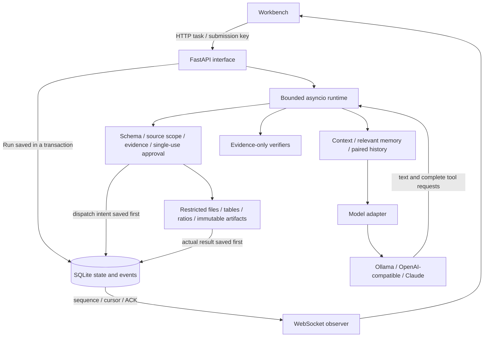

# Architecture

[繁體中文](architecture.zh-TW.md)

One runtime serves every task. Data analysis and document indexing differ only in the sources selected and in the model's own tool choices; nothing in the runtime selects a fixed runner or answer from the task text. The model adapter only translates protocols, the context builder selects bounded background, tools validate and execute capabilities, and the store persists state and events. The scripted fixture replaces only the model's transport.

## From a task to the next decision

`web.py` accepts a task with its sources and limits and saves the Run before the runtime starts. Each Session has at most one active Run; a semaphore bounds concurrency across Sessions, and blocking file and SQLite work runs in threads. A dropped WebSocket does not stop the work.

Until a plan is saved the model is offered only `plan_update`. Afterwards the catalogue depends only on Run state — the selected source types, whether there is a base artifact or a staged draft, whether something was published, whether a correction is pending — never on the task text. The catalogue is enforced: after the executor's own checks (schema, scope, evidence, review and completion gates, each with its specific error), a call to a tool the request did not offer is refused before dispatch with a correctable `tool_not_offered`. The JSON-tools protocol already rejects such names while decoding. Each `model.requested` event records the offered tool names and a SHA-256 of the exact request body.

Each step assembles the real model request and checks it against a conservative context bound before sending it. Complete history turns, source excerpts and relevant memory versions are selected by rule. Over budget, the runtime applies these moves in order, re-measuring after each one and recording it as a `context.pruned` event with its reason:

1. Drop the oldest complete history turns from earlier Runs, then the optional source excerpts.
2. Drop the model's narration next to successful tool groups (call arguments and results stay; the narration remains in events and the UI).
3. Remove tool errors that a later call already corrected or superseded.
4. Move tool groups the model has already read into an exact evidence snapshot that keeps every evidence ID and result field; identical shared source fields are stored once and restored field by field. The newest unread group, error groups and publication groups are protected.
5. Shorten the prompt-side catalogue: tool descriptions, then schema bounds (lengths, item counts, patterns), runtime guidance, inspection hints and artifact-name descriptions. The executor still enforces the full schemas. Tool names, parameter names and types, and system rules are never changed.
6. Re-encode without loss: drafts and repeated plans by reference (review and receipt modes), and, after publication, the labelled-line view already contained in a source's text and the whitespace in tool-result JSON.
7. If the request still does not fit, stop with `context_limit_exceeded`.

Steps 1, 2 and 5 lose information and are recorded as such; the context as a whole is not claimed to be lossless.

The adapter normalises text and tool requests and never executes a streamed call whose arguments are incomplete. `Tools.prepare` validates the schema, workspace scope and evidence references and produces the effective arguments. When approval is required, the exact pending operation and its digest are stored and the run waits; an approval applies once, to that Run, call and argument set. The dispatch intent is persisted before the tool runs. The real result goes back to the model, which chooses the next step. Correctable errors carry the remaining budget and `correctable_fields`; operations with unknown effects are not retried.

Artifacts are stored with an immutable identity, SHA-256 and exact bytes. A revision pins its completed base and adds a version instead of overwriting.

## Verifiers

Before publication the runtime runs the verifiers in `verifiers.py`. **They receive only the candidate content and the server-held tool evidence, never the task text**, so they cannot encode answers for particular tasks. They reject only statements the tool results do not support:

- **Calculation citations.** A computed value cited to evidence that did not produce it is rejected. When evidence spans several sources, a computed value must cite its calculation on the same line; with a single source the server's evidence appendix already links every value.
- **Consistent source roles.** Each artifact value that matches a labelled source value takes that source label as its role. One output field holding values of two different roles (for example an escalation contact filled in as the owner) is rejected, with feedback that says which document to change under each reading of the field. Parenthetical role annotations in labels do not create a separate field; a value whose own text states its role is exempt. With only one document there is nothing to compare, so the check stays silent.

The completion reply is checked as well. After publication the finalization request includes the published body (without the server appendix, up to 6000 bytes; larger bodies are omitted with an event) so the model describes the artifact rather than restating the task. `completion_summary` sees only the reply and the published artifacts: a clause naming an item the artifact marks missing everywhere must say it is missing, and numbers in the reply must appear in the artifact (single-digit counts exempt).

Every failure returns to the model as a correctable error; the model decides how to fix it.

## Providers

The runtime depends on a small protocol (`DecisionModel` in `model.py`): `request_body`, `context_budget`, `decide`, `settings` and `info`.

| Provider | Adapter | Notes |
|---|---|---|
| Fixture | `ModelAdapter` + `FixtureTransport` | Deterministic, clearly labelled; proves control flow only. |
| Ollama | `ModelAdapter` | Verifies the installed model digest and renderer; exact context accounting for Qwen3.5; optional JSON-tools protocol for small local models. |
| OpenAI-compatible | `ModelAdapter` | Any Chat Completions endpoint with native tool calling. HTTPS only (plain HTTP only for loopback servers); the key is read from a named environment variable. |
| Claude | `AnthropicAdapter` | Official `anthropic` SDK, Messages API. Translates the runtime's Chat Completions history into Messages turns (top-level system, `tool_use` / `tool_result`, alternating roles, `is_error` for failed tools) and back. |

Remote context budgets use a labelled UTF-8 byte upper bound, because those tokenizers are not verified locally.

Current Claude models always think and bind each thinking block to the exact conversation prefix that produced it, while this harness deliberately rewrites history (pruning, executor-state snapshots, publication finalization). Replaying a block after such an edit is rejected, so the Claude adapter never replays thinking blocks: each turn is answered without the model's previous private reasoning. This is a documented trade-off, not an oversight.

## Local access

The app answers only to loopback host names (DNS-rebinding defence) and refuses foreign `Origin` headers. The command-line entry point also requires a per-launch access token: a browser presents `/?token=…` once and receives an HttpOnly, SameSite=Strict cookie named after the token, so workbenches on other ports never share it; scripts send `Authorization: Bearer <token>`. Every response refuses framing and sends no referrer.

## Execution and observation are separate

Store events are the authoritative sequence and are persisted before the UI is notified. Observers de-duplicate with a contiguous cursor and acknowledge to bound slow clients; after a terminal event they still read the persisted sequence to the end. Re-submitting the same key and content returns the original Run.

A cancel request, an executor that has stopped, and whether an effect is known are separate facts. Terminal states cannot be reopened by late results; a dispatched tool may be left `unknown`. Context and memory never grant permissions; tool scope and approvals are always enforced by the executor.

## Restart path

`StoreLease` takes an OS-level exclusive lock before SQLite is opened; a dead process releases the kernel lock, so a leftover lock file does not mean the service is alive. A new service finds Runs that lost their executor: dispatches without a result become `unknown`, and local artifacts are reconciled only when the call identity and exact bytes match. Checkpoints keep confirmed results, pending work, paired model messages and artifact references.

Resume takes only a digest and key. The server loads the checkpoint, validates the Session, model and source versions, artifacts and current resume blockers, then creates a new Run. Old approvals are invalid; confirmed operations are answered from saved results, and new effects that need approval are confirmed again. Old checkpoint payloads are never rewritten; admission diagnostics are recomputed after upgrades so incomplete legacy intent cannot bypass checks.

## Reading order

- `contracts.py` — limits, tool requests and prepared arguments, `PendingCorrection`, failure categories.
- `web.py` → `runtime.py` — public interface, lifecycle, bounded decision loop and stop conditions.
- `model.py`, `anthropic_adapter.py`, `streaming.py` — provider protocols, complete requests, stream normalisation.
- `tools.py`, `sources.py` — schemas, admitted sources, tools and evidence IDs.
- `verifiers.py` — task-independent checks before publication and completion.
- `context.py` — paired history, budgeting and lossless moves of confirmed groups.
- `storage.py`, `ownership.py`, `checkpoints.py` — transactions, immutable artifacts, OS ownership, `unknown` effects and resume.
- `event_stream.py`, `static/run-stream.js` — persisted sequence, ACK, catch-up and de-duplication.

## Testing seams

Tests drive the public HTTP/WebSocket interface and replace only the model's HTTP transport (an `httpx` transport for Chat Completions providers, an `httpx2` transport for the Anthropic SDK). Controlled faults use the same start-up switches as the validation scripts (`fault_once_source_read`, `hold_first_tool`), and the test client's host name is allowed in `tests/conftest.py` only. They use real temporary SQLite stores and files. Real subprocesses verify crash recovery; vendored source snapshots of earlier releases verify store and checkpoint upgrades; recorded real-model runs verify context handling. Browser walkthroughs and real-model quality runs are separate evidence (see [evaluation](evaluation.md)).
