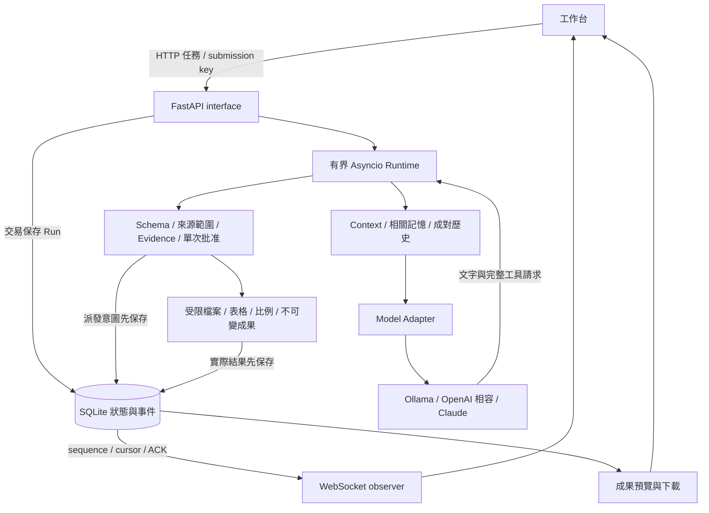

# 實際架構與資料流

[English](architecture.md)

用途不決定固定runner：資料分析與文件索引都使用同一Runtime。ModelAdapter只轉換模型協定；Context Builder選入有界背景；Tools驗證／執行能力；Store保存狀態與事件。fixture只替代外部模型transport。

## 從輸入到下一次決策

web.py接收Task、選取來源與限額，先保存Run才啟動Runtime。每Session最多一個活動Run，Runtime以Semaphore限制不同Session的並行；同步檔案與SQLite工作移到thread，WebSocket斷線不代表服務任務消失。

Runtime未保存計畫時，只向模型提供plan_update；成功保存或checkpoint已有確認計畫後，工具catalog只依Run狀態決定（所選來源類型、是否有基準成果或草稿、是否已發布、是否有待修正錯誤），不依任務文字。catalog會被強制執行：executor先做原有檢查（schema、scope、證據、審閱與完成條件，各有專屬錯誤碼），通過後若工具不在本次請求的清單中，就在派送前以可修正的tool_not_offered拒絕（json_tools協定在解碼時就已拒絕）。每個model.requested事件記錄提供的工具名稱與實際請求內容的SHA-256。Runtime每步組裝實際模型請求，先核對渲染後保守Context上限。完整歷史回合、來源片段、相關版本記憶依規則選取。超預算時可先省去成功工具組旁的模型重複敘述；call參數與全部結果保持，原公開文字仍存於事件／UI，不裁切使用者約束或錯誤組。已被後續模型讀過的成功工具組可搬成精確伺服器證據快照，保留EID與所有result欄位；完全相同的共同來源欄位可由source_ref連至evidence_sources，逐欄還原原result；最新未讀、錯誤及發布組受保護，原事件不裁切。實際順序是：先省略較舊的完整歷史回合與可選來源片段；再省去敘述；移除已被後續呼叫修正或取代的錯誤；搬移已讀工具組；接著縮短提示中的工具目錄（description、schema長度／數量／pattern上限、執行期指引、檢查提示、成果檔名說明，executor仍執行完整schema）；最後做無損重新編碼（草稿與重複計畫改以參照表示，發布後省略來源文字已含的labelled_lines檢視與工具結果JSON空白）。每一步都重新量測並記錄context.pruned事件與原因；工具名稱、參數名稱與型別、系統規則不改。仍超限就以context_limit_exceeded明確停止。這也是有損說明省略，不能宣稱整個Context無損。

Adapter正規化文字與工具請求；串流參數未完整時不執行。Tools.prepare驗證schema、工作區及引用，產生有效參數與scope。需要批准時，完整待執行內容與digest保存後等待決定；批准只供這個Run/call/有效參數使用一次。派發前Store保存意圖，再呼叫工具。工具真結果回到模型，讓它選下一步；可修錯誤包含剩餘預算及correctable_fields，其他未知效果不自動重試。

Artifact使用不可變身分、SHA及精確bytes保存。版本修改釘住完成Run的基底，新增成果而不覆寫原檔。數值與來源引用由工具證據生成；模型正文仍需獨立內容核對。

發布前，Runtime 依序執行 verifiers.py 的通用驗證器。驗證器的輸入只有候選正文與伺服器保存的工具證據，**不接收任務文字**，因此無法針對特定任務寫答案規則；它只拒絕沒有工具結果支持的說法。`consistent_source_roles` 檢查同一個輸出欄位是否混放了來源中不同角色的值（例如把升級聯絡人填進負責人欄）：成果中每個與來源標籤值相符的值，以來源標籤為它的角色；值的同一行若已寫明來源角色則不計。只有一份文件時沒有可比較的第二個值，因此不做判斷。另外，正文把計算值引用到錯的證據時拒絕；證據跨多個來源時，計算值必須在同行引用產生它的計算證據（單一來源時伺服器附錄已足以追溯，與正文來源連結規則一致）。失敗以可修正錯誤回饋給模型，由模型決定如何修改。

完成回覆同樣受檢查。發布後的收尾請求會附上已發布正文（不含伺服器附錄，上限 6000 bytes，超過則省略並記錄事件），讓模型描述的是這份成果而不是重述任務。`completion_summary` 只看回覆與已發布成果：回覆中提到成果標示為缺項的項目時，同一句必須說明它缺少（若同一標籤在成果別處有實際值，例如一份會議有決議、另一份沒有，就不據此拒絕）；回覆中的數值必須出現在成果裡（個位數計數除外）。不符時以可修正錯誤只開放 `summary` 欄位。不論模型怎麼結束都做同樣的檢查：發布後所有真實模型（包含遠端模型）都會被提供 `task_finish`，發布後的純文字結束也會受檢查；不符的回覆不放入下一次請求，改為只開放 `task_finish` 的可修正步驟，系統訊息附上拒絕原因。收據模式不產生自由摘要，因此不做這項檢查。工具目錄同樣不依任務措辭調整，只依Run狀態提供。

## 模型供應商

Runtime 只依賴 `model.py` 的 `DecisionModel` 介面（`request_body`、`context_budget`、`decide`、`settings`、`info`）。支援四種供應商：fixture（固定腳本，只證明控制流程）、本機 Ollama（核對模型 digest 與 renderer，Qwen3.5 可精確計量，小模型可用 JSON-tools 協定）、OpenAI 相容端點（原生 tool calling，只允許 HTTPS，loopback 例外，API key 從指定環境變數讀取），以及透過官方 `anthropic` SDK 的 Claude（Messages API，把 Runtime 的 Chat Completions 歷史轉成 Messages 格式再轉回）。遠端模型的 Context 上限以標明的 UTF-8 bytes 上界計算。

目前的 Claude 模型一定會思考，且每個思考區塊綁定產生它的對話前綴；本 harness 會刻意改寫歷史（裁切、執行狀態快照、發布後收尾），改寫後重送思考區塊會被拒絕，所以 Claude adapter 從不重送思考區塊，模型每一輪看不到前一輪的私密推理。這是明確記錄的取捨。

## 無頭用戶端

`agent_harness_demo.headless` 只是一般的觀察者：透過 HTTP API 建立工作區、Session 與 Run，再以 `flow=ack` 讀取持久事件串流，逐筆確認，串流中斷時從最後的 cursor 重新接上（已輸出的序號會略過）。它原樣輸出事件為 NDJSON，並把終止狀態對應成退出碼。觀察者從不擁有執行，所以用戶端結束時 Run 仍會繼續。重新連線的路徑目前還沒有測試。

## 執行與觀察分開

Store事件是權威序列，先持久保存才通知UI。observer用連續cursor去重補讀，ACK提供有界慢客戶端行為；終態後仍要讀完持久序列，不能只見舊terminal就忽略後續恢復資料。同key／同內容提交查回原Run，不因網路重試新增工作。

取消要求、執行器已停止、效果是否已知是不同資料。終態不能被晚到結果重新開啟；已派發工具可能留下unknown。Context/Memory也不提供權限，工具scope及批准始終由executor強制。

## 重啟路徑

StoreLease在SQLite開啟前取得OS排他鎖；程序死亡會釋放kernel鎖，鎖檔留存不代表活著。新服務查失去執行者的Run：無結果的派發先unknown，本機成果只在call身分與exact bytes吻合時對帳。checkpoint保存已確認結果、待辦、成對模型訊息及成果引用。

明確Resume只收digest/key。伺服器查回checkpoint，驗證Session、模型／來源版本、成果及目前resume_blockers，再建立新Run。舊批准失效，是否需要批准沿用checkpoint.policy；相同已確認操作用保存結果回覆，需要批准的新效果重新確認。舊checkpoint原payload不改寫，升版後重新計算准入診斷，避免不完整舊意圖繞過檢查。

## 程式閱讀順序

- contracts.py：RunLimits、工具請求／準備後參數、PendingCorrection與失敗分類。
- web.py → runtime.py：公開介面、生命週期、受限決策循環及停止條件。
- model.py／streaming.py：外部HTTP協定、完整請求與串流正規化。
- tools.py／sources.py：schema、准入來源、實際工具與EID。
- verifiers.py：與任務無關的發布前驗證器，只看正文與工具證據。
- context.py：配對歷史、計量及完整已確認組的搬移；storage.py提供相關Memory／歷史版本。
- storage.py／ownership.py／checkpoints.py：交易、不可變成果、OS所有權、unknown及續做依據。
- event_stream.py／static/run-stream.js：持久序列、ACK、補讀及去重。

## Run 執行中追加訊息

在 Run 仍能做決策時（排隊、執行中或等待批准），`POST /api/runs/{id}/messages` 以用戶端產生的 `message_id` 追加訊息。重送相同 ID 與內容會拿回原本的受理結果；同一 ID 換成其他內容視為衝突。Runtime 在每一步開始時，把排隊中的訊息以使用者回合接在最新工具結果之後送出，因此不會改動正在生成的那次請求。只開放單一修正工具的步驟（發布、完成或收尾修正）會讓訊息繼續排隊，因為模型在該步無法據以行動。受理與送達都是事件（`message.queued`、`message.delivered`）；`history_turn` 會重播已送達的訊息，版本修改與 checkpoint 都看得到。Run 結束時仍在排隊的訊息，會在終止事件之前以一個 `message.undelivered` 事件回報。

## 本機存取

服務只回應loopback主機名稱（防DNS rebinding），並拒絕外來Origin。命令列啟動時另需每次啟動的存取權杖：瀏覽器第一次以 `/?token=…` 開啟後換成以權杖命名的HttpOnly、SameSite=Strict cookie（不同埠的工作台不會互相覆蓋）；腳本送 `Authorization: Bearer <token>`。所有回應都禁止被嵌入框架，也不送出referrer。

測試始終走已確認的HTTP／WebSocket與外部模型transport接縫，使用真實暫存SQLite與檔案。真子程序驗證程序死亡，實際瀏覽器驗證操作路徑，真實9B驗證語意；三種證據各有邊界。

### 模型旁白與歷史的界線

後續請求可能省略成功工具組的模型旁白；原文在持久事件與畫面保留，工具請求／結果與使用者約束保持完整。共同來源欄位可以精確還原result，這不代表模型旁白也無損留在Context。

普通Session歷史位於當前回合邊界前，不參與旁白省略；Resume的checkpoint訊息在當前回合邊界後加入，其中成功組的旁白也可能省略。原checkpoint資料不改寫，結果及證據仍保留。

## 驗收身分

服務建立時從實際package路徑捕捉來源／資源raw bytes的穩定指紋，排除Python快取；config只回這份固定身分，不依即時HEAD或磁碟內容更新。兩個驗收記錄器在任何Run前比對本repo package，manifest另存localHEAD。Git cwd固定腳本repo，成果以ID隔離保存並列入匯出manifest。這是可重現證據歸屬，不是遠端安全認證或模型品質保證。

## 明確算式的發布檢查

ToolExecutor在批准／派發前檢查引用依賴閉包。若包含CSV來源，正文中所辨識的有界明確算式，其結果必須等於已引用數值工具的Decimal結果，或是引用來源已存在的公式。已引用來源路徑不當成算式；CSV文字也按欄位解析，避免分隔符與千分位混淆。拒絕回傳invalid_evidence，模型可在原修正額度內另行計算及改稿；伺服器不自動補算或重送。

這只是部分結果來源檢查，不驗證運算元、公式是否成立、數值與欄位／角色的關係，也不解析所有自然語言或記法。來源公式被引用不等於已重新計算。固定案例仍須通過數值工具oracle與獨立逐項內容核對。

模型政策以精簡中文集中表達，成果與狀態仍依使用者語言。正文引用要求原檔名搭配EID，工具citations參數只含ID。缺證據時可先使用前置工具；correctable_fields僅約束被拒call的改動。同一項擇一要求的受支持選項不解除其他必填項。這些是模型引導，不是伺服器對任意自然語言的完整語意驗證。

source_read額外提供可選labelled_lines：一般視圖維持冒號後空白或空值的保守格式，附原行號、標籤與值，保留重複項及值尾空白；不推斷角色、必填欄位或缺值。它不是完整欄位schema，沒有視圖不代表沒有該欄位。原text與hash始終保留；全視圖超過16項或2048JSONbytes便整體省略，不給部分視圖。URI形狀候選不放入一般視圖。解析在thread執行，不改來源准入或增加工具權限。此表示法能否改善模型角色對應仍由真實案例核對。

source_read.labels可由模型指定至多8個唯一、大小寫精確的原標籤。非CSV模型目錄要求明示此參數，[]表示探索原文、不產生查詢結果；非空才查標籤。executor仍相容省略參數的原文讀取；目錄生成profile是有效呼叫的子集，不等於已強制模型採用查詢。label_queries回傳各標籤的全部字面匹配（行號／值）；即使一般視圖被省略，查詢仍掃描完整原文。complete=true的空匹配只表示此字面grammar沒有該標籤，不證明任意格式／語意角色缺失。匹配超過16項、結果超過2048JSONbytes或被查標籤遇URI歧義時，整組complete=false、matches=null，不能當缺資料。CSV-only模型目錄不包含此參數或指引；來源範圍及executor驗證不依目錄放寬。

ModelSettings.thinking與CLI的--thinking為明確可選設定，預設關閉。僅已核對的qwen35布林思考metadata可開啟；其low相容別名代表開啟，不宣稱是低等級思考。模式使用不同context_profile，既有Resume配置比對會拒絕跨模式續做。上限保守多計每個assistant空思考框架，隱藏reasoning欄位不進可見事件或後續請求。串流與非串流均拒絕已標示截斷的回覆，不能因工具參數碰巧可解析或成果已發布就完成Run。此設定尚未真模型驗收，啟用方案與限制記錄於開發紀錄。

ModelAdapter以ModelResponseError回報無效回覆的安全形狀：固定reason、正規化finish、可見文字長度、工具數量、reasoning是否出現及過濾用量。Runtime沿既有取消優先與持久化失敗路徑保存diagnostics；不保存供應商原文、私密推理或無效工具參數。SSE只額外回傳finish與觀察旗標，正常Decision及後續模型訊息不加入這些欄位。這提升可診斷性，不改變有效回覆／完成判準。

思考profile可在確認發布後使用task_finish(summary)，由既有工具驗證／scope／持久意圖／dispatch／結果保存處理。Runtime將plaintext final與此操作接到同一成果／pending／取消門檻；finish需獨立model決策，計入原工具限額。目錄只在thinking/plan/成果就緒時呈現，並非權限；自己的可修正finish參數錯誤可經新決策修正，其他錯誤繼續阻擋。公開結語取自模型summary，不再額外生成確認回執；空模型回覆仍失敗。完成操作契約記錄於開發紀錄。
