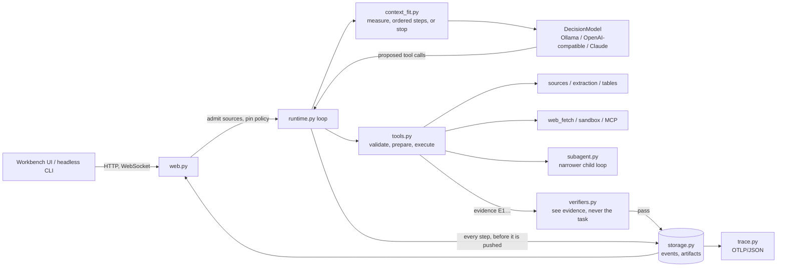

# Design decisions

[繁體中文](design-decisions.zh-TW.md)

The reasons behind the harness's main choices: what was chosen, what was turned down, and what the choice costs. [Architecture](architecture.md) describes how the parts work; this note is about why they are shaped this way.

## 1. The model proposes; the harness decides

**Choice.** A tool call from the model is a proposal. The executor checks it against the schema, the sources selected for this Run, the tools offered at this step and any approval, and only then runs it. The tool set itself is the boundary: read selected sources, compute over them, publish a cited artifact.

**Turned down.** Giving a general agent broad tools (a shell, file edits) and gating them with permission rules afterwards, as coding agents do. That needs a sandbox and a policy language to be safe, and neither would be the point of this project.

**Cost.** The harness cannot do open-ended work. Each new capability (web pages, Python, subagents) had to be added as its own tool with its own limits.

## 2. Verifiers see the evidence, never the task

**Choice.** Before an artifact is published or an answer accepted, verifiers check it against the evidence the Run's tools produced: cited IDs exist, computed values cite the calculation that produced them, a field is not filled from a source line with a different role, the completion summary matches what was published. They are not given the task text.

**Why.** An earlier version passed all six evaluation cases with about 450 lines of rules written against the tasks' wording. Removing them dropped the same model to 3/6, which showed that part of the earlier score was the rules. A verifier that cannot read the task cannot encode an answer to it.

**Cost.** Errors that need the task to detect are not caught: a misread instruction, or a number taken from the wrong column and cited correctly. These are listed in the [evaluation notes](evaluation.md) as known gaps instead of being patched per case.

## 3. Intent is saved before anything runs, and unknown effects are never retried

**Choice.** A prepared call is written to the store (`tool.dispatched`) before it executes, and its result is written before the event is pushed. After a crash, a call whose result was not saved is reported as *unknown*; continuing is an explicit new Run that reuses confirmed results and never re-runs an unknown effect.

**Turned down.** Automatic retry or rollback. Neither is correct in general: a retried publish may publish twice, and an external effect cannot be rolled back.

**Cost.** The user must decide after an interruption. Read-only calls could be retried safely and are simply re-decided by the model instead.

## 4. Events go to SQLite first, then to the client

**Choice.** Every step is an event row written in the same transaction as the state it changes; the WebSocket reads from the table with a cursor and acknowledgements. The trace export and the checkpoints are derived from the same rows.

**Why.** A live-only event bus loses whatever happened while the client was disconnected, and then the UI and the stored state can disagree. With one ordered log there is one answer to "what happened".

**Cost.** A write per event, and a single SQLite file: this is a single-process, single-user design.

## 5. An approval covers exactly one call

**Choice.** An approval is bound to a digest of the Run, the call ID, the tool, its canonical arguments and its scope. It is used once and ends as approved, denied, expired or cancelled. There is no "always allow".

**Turned down.** Session-wide grants, which are convenient and are how a later, different call ends up covered by an earlier yes.

**Cost.** More prompts. Unattended runs therefore stop at the first approval (`--unattended`, exit code 5) instead of guessing.

## 6. Context is measured, then reduced in a fixed order, then the Run stops

**Choice.** Each request is measured against a conservative bound before it is sent. Over the bound, `context_fit.py` applies a fixed list of steps, lossless ones first, and records each as an event. If the request still does not fit, the Run fails with `context_limit_exceeded`.

**Turned down.** Rolling summaries by default. A summary the user cannot inspect silently changes what the model knows.

**Later addition.** Compaction, opt-in per Run. It replaces evidence text only in the model's view with a labelled summary; the evidence that citations and verifiers use keeps the full text. So a wrong summary can make the model answer worse, but it cannot make a wrong claim pass verification.

**Cost.** Without compaction, a document larger than the window cannot be used. With it, what the summary drops is lost to the model.

## 7. A subagent is a loop inside a tool call, not a second Run

**Choice.** `subagent_run` executes a small loop inside the parent's tool call. It shares the parent's cancellation, deadline, budget and event log. The child has its own tool instance over a subset of the parent's sources, read-only tools only, and cannot delegate.

**Turned down.** Making the child a full Run. The store assumes one active Run per session, and history, recovery and usage would all need a parent/child notion. The simpler shape gives the two properties that matter: an isolated context and narrower permissions.

**How evidence crosses.** The child's answer must pass `verify_answer` against the child's own evidence. The parent receives one evidence record: the report, labelled as model-written, with the child's evidence IDs rewritten to source names (they would collide with the parent's) and the source versions it was verified against.

**Cost.** Subagents run one at a time, and a crash during a sub-task loses that sub-task's progress.

## 8. New capabilities are off twice

**Choice.** Web access, the Python sandbox, subagents, the vision model and container OCR must be enabled when the workbench starts; the first three must also be chosen for each Run. A Run that asks for something the workbench does not allow is refused at admission.

**Why.** The person who starts the service and the task that runs in it are different decisions. A startup flag alone would give every task the capability; a per-Run flag alone would let a task turn it on.

**The same rule for starting work.** A routine is a saved Run request with a trigger endpoint. It can start a Run when nobody is watching, and that is all: the Run admits current sources and keeps its limits, verifiers and approvals, and an approval nobody answers expires. A trigger is never a grant.

## 9. Model output is always labelled as model output

**Choice.** Three things the model writes can become evidence: a vision model's transcription of an image, a subagent's report, and a compaction summary. Each is labelled in the text the model reads, in the evidence record, and in the artifact's appendix or the `answer.verified` event. Where a second reading exists (OCR next to a transcription), disagreements are listed, not resolved.

**Why.** The citation chain is only worth something if a reader can tell a file's words from a model's account of them.

## 10. One loop for every provider

**Choice.** The runtime depends on a small protocol (`request_body`, `context_budget`, `decide`). Ollama, OpenAI-compatible endpoints and Claude sit behind it. For small local models a JSON-schema protocol replaces native tool calling, because it makes their output parseable far more often. Claude's thinking blocks are never replayed, since the harness rewrites history and a replayed block would no longer match its prefix.

**Cost.** Provider-specific features (prompt caching, server tools) are not used.

## 11. What was left out, on purpose

- **A shell and file edits.** They need a real sandbox and change what the project is about. Python runs only in a locked-down container, with sources mounted read-only.
- **Multi-user hosting.** It needs authentication, tenant isolation and a different store. The README says so instead of offering a half version.
- **A document store with embeddings.** Sources are a handful of files the user selected, so there is nothing to index. What exists is `source_search`: lexical retrieval inside one selected source that returns exact lines with line numbers, so retrieved text is evidence like any other read. Semantic retrieval over hundreds of documents would need an embedding model and an index, and a way to keep citations exact; that is not built.
- **Plugins.** MCP, skills and hooks cover extension without loading third-party code into the process.

## 12. Evaluation records what happened

**Choice.** Truth and grading checks are written before a suite runs. Every run is kept; nothing is rerun for a better score, and a check that turns out to be too strict still counts as a failure in that batch. Fixes prompted by a batch are made afterwards and labelled as such.

**Why.** The numbers are small-sample results from one 9B model. They are useful only as honest observations of where the harness helps and where the model fails; a tuned 100% would say nothing.
