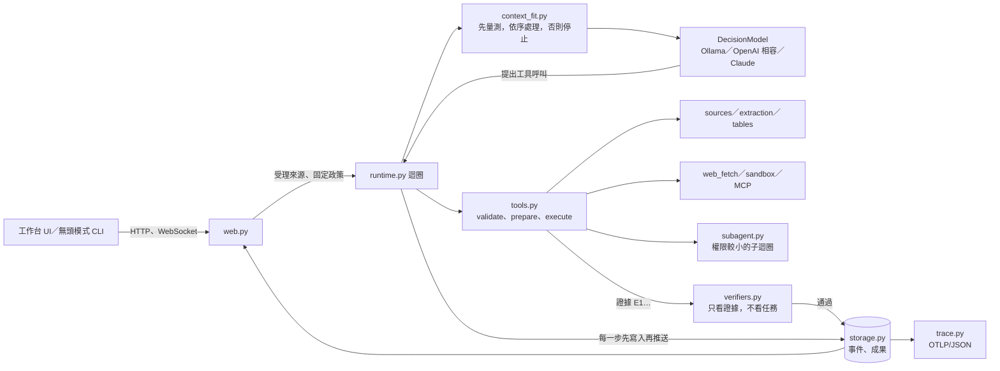

# 設計決策

[English](design-decisions.md)

這份文件說明 harness 主要設計背後的理由：選了什麼、沒選什麼、這個選擇的代價是什麼。[架構文件](architecture.zh-TW.md)說明各部分怎麼運作；這裡說明為什麼是這個形狀。

## 1. 模型提案，harness 決定

**選擇。** 模型的工具呼叫只是提案。執行器先對照 schema、這個 Run 選定的來源、這一步提供的工具以及核准狀態，通過後才執行。工具集本身就是邊界：讀選定的來源、對它們計算、發布有引用的成果。

**沒有選的做法。** 像程式碼代理那樣，給通用代理廣泛的工具（shell、改檔），再用權限規則事後管制。那需要沙箱和一套政策語言才安全，而這兩者都不是這個專案的重點。

**代價。** harness 做不了開放式的工作。每個新能力（網頁、Python、子代理）都得做成獨立的工具，各有自己的限制。

## 2. 驗證器只看證據，不看任務

**選擇。** 成果發布或答案被接受之前，驗證器會對照這個 Run 的工具產生的證據檢查：引用的 ID 存在、計算值引用了產生它的計算、欄位沒有被填入角色不同的來源內容、完成摘要和已發布的成果一致。驗證器拿不到任務文字。

**原因。** 早期版本靠大約 450 行針對題目措辭寫的規則，通過了全部六個評估案例。移除這些規則後，同一個模型掉到 3/6，表示先前的分數有一部分是規則撐出來的。讀不到任務的驗證器，就沒辦法把答案寫進去。

**代價。** 需要任務文字才能發現的錯誤抓不到：誤讀指示，或是數字取自錯誤的欄位但引用格式正確。這些都列在[評估紀錄](evaluation.md)的已知缺口裡，而不是針對個別案例補規則。

## 3. 先保存意圖再執行；效果未知的操作不重試

**選擇。** 準備好的呼叫在執行前先寫入儲存（`tool.dispatched`），結果寫入後才推送事件。當機之後，結果沒有保存的呼叫會回報為「未知」；繼續執行必須明確建立新的 Run，它會沿用已確認的結果，而且不會重跑效果未知的操作。

**沒有選的做法。** 自動重試或回滾。兩者在一般情況下都不正確：重試發布可能發布兩次，外部效果無法回滾。

**代價。** 中斷後要由使用者決定。唯讀呼叫其實可以安全重試，這裡的做法是讓模型重新決策。

## 4. 事件先寫入 SQLite，再送給用戶端

**選擇。** 每一步都是一筆事件，和它改變的狀態在同一個交易中寫入；WebSocket 以游標和確認機制從資料表讀取。追蹤匯出和 checkpoint 也由同一批事件推導。

**原因。** 只有即時推送的事件匯流排，會漏掉用戶端斷線期間發生的事，UI 和儲存的狀態就可能不一致。只有一份有序的記錄，「發生了什麼」就只有一個答案。

**代價。** 每個事件都要寫一次，而且只有單一 SQLite 檔案：這是單一行程、單一使用者的設計。

## 5. 一次核准只涵蓋一次呼叫

**選擇。** 核准綁定一個雜湊值，內容包含 Run、呼叫 ID、工具、標準化後的參數與範圍。核准只能用一次，結果只會是核准、拒絕、過期或取消。沒有「一律允許」。

**沒有選的做法。** 整個對話通用的授權。它很方便，但也正是「先前的同意被後來不同的呼叫沿用」的來源。

**代價。** 提示比較多。因此無人值守的執行會在第一個核准請求時停止（`--unattended`，退出碼 5），而不是自行猜測。

## 6. 上下文先量測，依固定順序縮減，再不行就停止

**選擇。** 每個請求送出前，先對照保守的上限量測。超出時，`context_fit.py` 依固定順序套用一連串步驟，無損的在前，每一步都記錄成事件。仍然放不進去時，Run 以 `context_limit_exceeded` 失敗。

**沒有選的做法。** 預設就做滾動摘要。使用者看不到的摘要，會默默改變模型知道的內容。

**後來加入的選項。** 壓縮，由每個 Run 選擇開啟。它只把模型視角中的證據文字換成標示過的摘要；引用與驗證器使用的證據仍保有全文。所以錯誤的摘要會讓模型答得比較差，但不會讓錯誤的主張通過驗證。

**代價。** 不開壓縮時，比上下文還大的文件無法使用。開了之後，摘要漏掉的內容模型就用不到。

## 7. 子代理是工具呼叫內的迴圈，不是第二個 Run

**選擇。** `subagent_run` 在父 Run 的工具呼叫內執行一個小迴圈，共用父 Run 的取消、期限、預算與事件記錄。子代理有自己的工具實例，範圍是父 Run 來源的子集，只有唯讀工具，也不能再委派。

**沒有選的做法。** 把子代理做成完整的 Run。儲存層假設每個對話同時只有一個執行中的 Run，歷史、恢復與用量也都得加入父子關係。較簡單的做法已經提供真正重要的兩個性質：隔離的上下文與較小的權限。

**證據如何跨越邊界。** 子代理的答案要對照它自己的證據通過 `verify_answer`。父 Run 收到的是一筆證據：標示為模型撰寫的報告，其中子代理的證據 ID 已改寫成來源名稱（否則會和父 Run 的 ID 衝突），並附上驗證時對照的來源版本。

**代價。** 子代理一次只能跑一個；子任務執行中當機，該子任務的進度會遺失。

## 8. 新能力要開啟兩次

**選擇。** 網頁存取、Python 沙箱、子代理、視覺模型與容器 OCR 都必須在工作台啟動時開啟；前三項還要由每個 Run 個別選用。Run 要求工作台不允許的能力時，在受理階段就會被拒絕。

**原因。** 「誰啟動服務」和「哪個任務在裡面執行」是兩個不同的決定。只有啟動旗標，所有任務都會得到這個能力；只有 Run 的選項，任務就能自己把它打開。

## 9. 模型的輸出一律標示為模型的輸出

**選擇。** 模型寫的內容有三種可能成為證據：視覺模型對圖片的轉錄、子代理的報告、壓縮產生的摘要。每一種都會在模型讀到的文字、證據記錄，以及成果的附錄或 `answer.verified` 事件中標示。有第二種讀法時（轉錄旁邊有 OCR），不一致會被列出來，而不是擇一採用。

**原因。** 讀者必須能分辨「檔案原文」和「模型對它的描述」，引用鏈才有價值。

## 10. 所有供應商共用一個迴圈

**選擇。** runtime 只依賴一個小型協定（`request_body`、`context_budget`、`decide`）。Ollama、OpenAI 相容端點與 Claude 都在它後面。對小型本機模型，以 JSON schema 協定取代原生 tool calling，因為這樣它們的輸出可解析的比例高得多。Claude 的 thinking 區塊不會重播，因為 harness 會改寫歷史，重播的區塊就對不上它原本的前文。

**代價。** 沒有使用各供應商特有的功能（prompt caching、伺服器端工具）。

## 11. 刻意不做的事

- **Shell 與改檔。** 它們需要真正的沙箱，也會改變這個專案的主題。Python 只在鎖定的容器中執行，來源以唯讀方式掛載。
- **多使用者部署。** 需要身分驗證、租戶隔離和不同的儲存層。README 直接說明不做，而不是提供半套。
- **搭配嵌入向量的文件庫。** 來源是使用者選定的少數檔案，沒有東西需要建索引。現有的是 `source_search`：在一個已選來源內做字詞檢索，回傳帶行號的原文，所以檢索到的文字和其他讀取一樣是證據。對數百份文件做語意檢索需要嵌入模型、索引，以及讓引用維持精確的方法；這部分沒有做。
- **外掛。** MCP、skills 與 hooks 已經能擴充，而且不必把第三方程式碼載入行程。

## 12. 評估記錄的是實際發生的事

**選擇。** 真值與評分條件在題組執行前寫好。每一次執行都保留；不為了更好的分數重跑，事後發現條件過嚴，在那一批仍然算失敗。由某一批引發的修正會在之後進行，並明確標示。

**原因。** 這些數字是單一 9B 模型的小樣本結果。它們的用處在於如實觀察 harness 在哪裡有幫助、模型在哪裡出錯；調出來的 100% 不能說明任何事。
